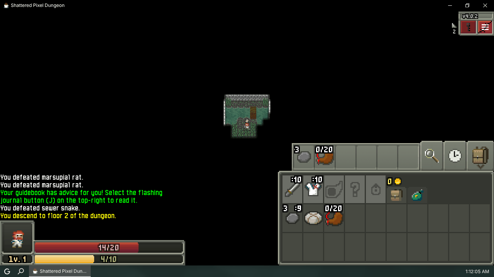
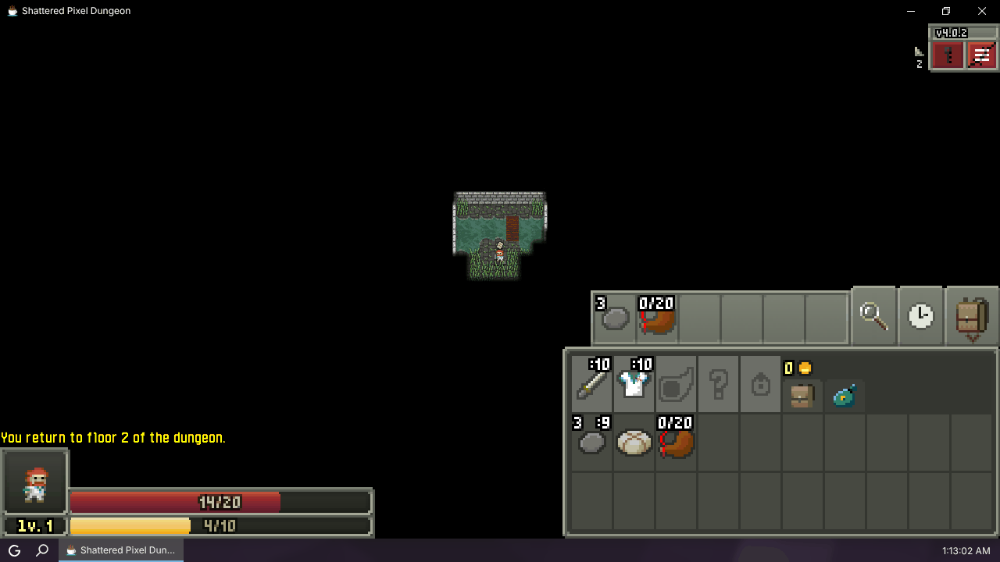
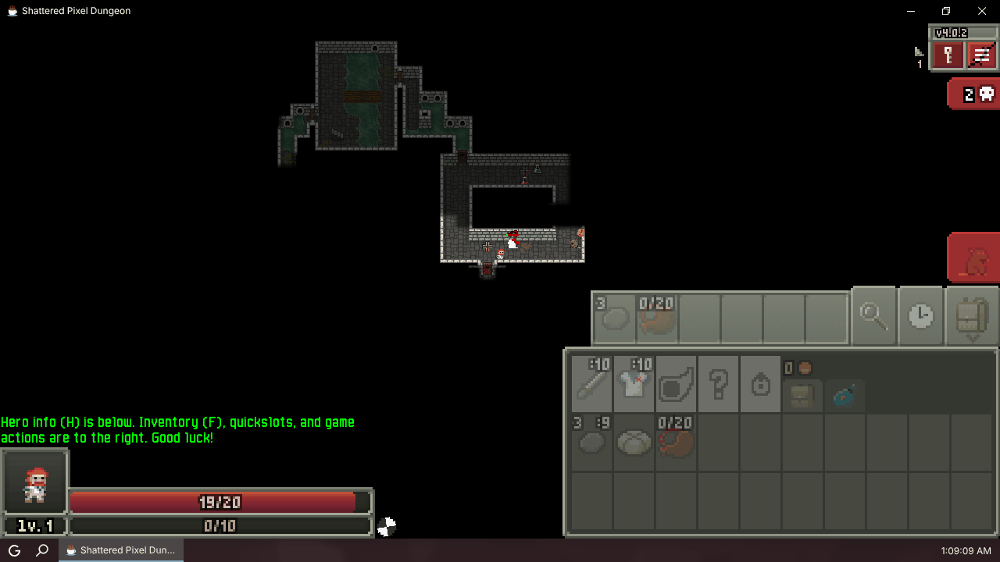
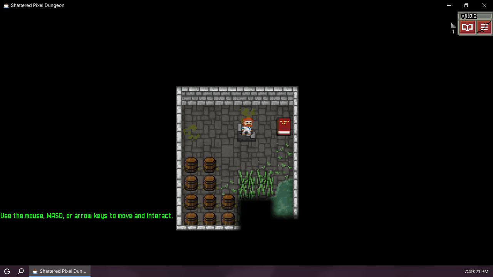
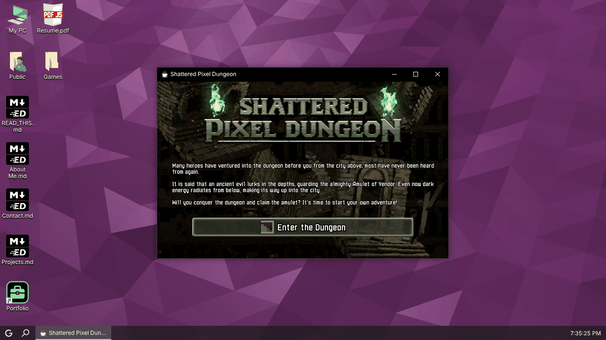
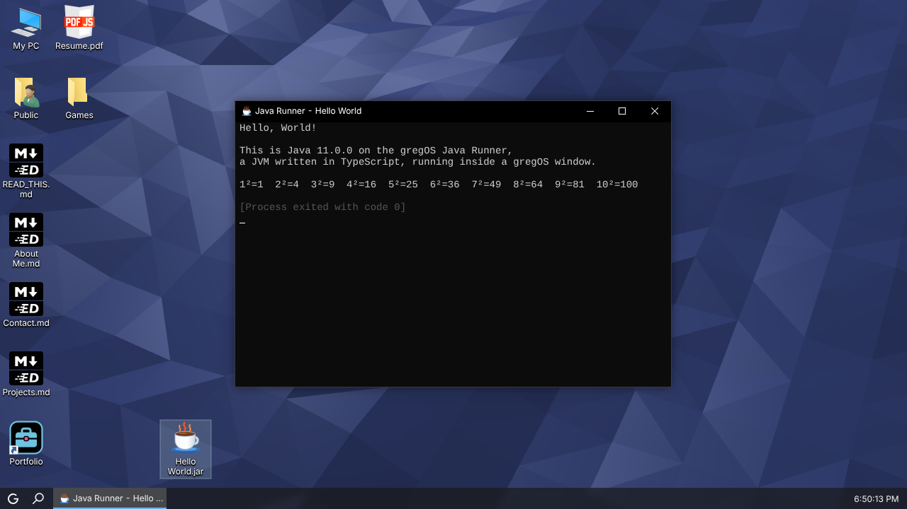

# Java Runner progress

> Written while the runner lived in gregOS; paths are gregOS paths. See
> [docs/README.md](README.md) for where they are in this repository.

## Summary

Milestones 0–7 are done and verified, and 8's JIT and lazy loading are in.
The JVM engine runs headless in Node (all 11 conformance programs match
OpenJDK 21 byte for byte, both interpreted and fully JIT-compiled) and in a
Web Worker inside gregOS. **Shattered Pixel Dungeon** v4.0.2
(`Desktop/Games/Java`, unchanged bytecode) runs in a Java Runner window
through the runner's own libGDX backend: WebGL2 canvas, FreeType text,
PNG/JPEG textures, keyboard and mouse, Web Audio, saves under
`/Users/Public/Saved Games/.shatteredpixel/`. The Playwright playthrough
`node scripts/javaRunner/shattered.cjs` (needs `npm run dev`) passed every
step in one run from a fresh profile: start a run, tutorial, move,
inventory, explore and fight, descend to floor 2, close the window (saves),
reopen and continue on floor 2 with the same health and experience.

Look first at the screenshots below, then `scripts/javaRunner/shattered.cjs`
and `components/apps/JavaRunner/jvm/jit.ts`. The next session should work on
browser performance (milestone 8): profile the game in Chromium, where
software WebGL and the GL call bridge dominate.

## Current milestone

**8. Performance.** With the JIT the title scene takes under 4 ms per frame
in Node (mock GL). In headless Chromium with software WebGL the game boots
in about 25 s and plays at a usable but uneven frame rate; a full scripted
playthrough takes about 20 minutes, mostly in the script's waits.

## Done

- **0. Recon and design.** `docs/java-runner/RECON.md` (generated by
  `scripts/javaRunner/recon.ts`) and `docs/java-runner/DESIGN.md`.
- **1. Class files and jars.** `components/apps/JavaRunner/jvm/classfile.ts`,
  `zip.ts` (lazy zip reader on `fflate`), multi-release lookup in `vm.ts`.
  `__tests__/components/apps/JavaRunner/classfile.spec.ts` parses all 2,817
  runtime classes and walks every instruction.
- **2. Interpreter core.** `jvm/interpreter.ts` implements every opcode the
  JVM spec defines except `jsr`/`ret` subroutines nested in `wide` edge cases
  (both forms are implemented but unused by modern javac). Conformance suite:
  `__tests__/components/apps/JavaRunner/conformance/` (sources, compiled
  classes, expected output from real `java`). Run with `npx jest
  __tests__/components/apps/JavaRunner` or, for diffs,
  `node --import ./scripts/javaRunner/register.mjs scripts/javaRunner/conformance.ts`.
  Programs: Arithmetic, Strings, CollectionsTest, Exceptions, Inheritance,
  Lambdas (streams, collectors), Threads (monitors, wait/notify, sleep,
  interrupts, ThreadLocal, executors, futures, atomics, ReentrantLock,
  latches, blocking queues, CompletableFuture), Misc, Reflection, IO (files,
  GZIP, Deflater/Inflater, CRC32, Properties), Text (regex, BigInteger,
  BigDecimal, Formatter, Scanner, UUID).
- **3. Threads and the scheduler.** Green threads with time slices (4 ms
  quantum inside 12 ms slices), monitors, `wait`/`notify`, timed waits,
  `sleep`, `join`, `park`/`unpark`, interrupts, uncaught exception handlers,
  daemon threads. `__tests__/components/apps/JavaRunner/scheduler.spec.ts`
  checks that `vm.stop()` ends a busy loop, `System.exit` codes and shutdown
  hooks, uncaught exception reports, and stdin.
- **4. gregOS app shell.** `components/apps/JavaRunner/` (`index.tsx`,
  `useJavaRunner.ts`, `session.ts` for the worker and console, and
  `javaRunner.worker.ts`). Registered in `contexts/process/directory.ts`,
  `.jar` mapped in `extensions.ts`, icon `public/System/Icons/*/java.*`, Start
  menu shortcut `Emulators/Java Runner.url`, `e2e/constants.ts` updated.
  Example jars in `Documents/Java Examples` (Hello World, Guess the Number).
  Console output goes to xterm; typed lines become standard input; the
  worker's file system requests are served from the gregOS file system.
  Screenshot: `node scripts/javaRunner/screenshots.cjs hello` (needs
  `npm run dev`). E2E: `e2e/components/apps/JavaRunner.spec.ts`.
- **5. Class library to boot the game.** The game runs `DesktopLauncher.main`
  unchanged. Runtime additions on the way: `RandomAccessFile`,
  `java.nio.channels.FileChannel`, `SecureRandom` (`crypto.getRandomValues`),
  the time zone database served from `java.home/lib`, SSL exception classes.
- **6. libGDX bridge.** Java backend in
  `components/apps/JavaRunner/java/gdx/` (built into
  `public/System/JavaRunner/gdx.jar` by `scripts/javaRunner/buildGdx.ts`) and
  natives in `components/apps/JavaRunner/gdx/`: WebGL2 (`gl.ts`), pixmaps and
  PNG (`pixmap.ts`, `png.ts`), FreeType (`freetype.ts`), buffers and matrices
  (`buffers.ts`), window/input/audio (`backend.ts`); page side in `page.ts`.
  The canvas is transferred to the worker and resizes with the window; the
  game's fullscreen request maximizes the gregOS window.
- **7. Playable.** `node scripts/javaRunner/shattered.cjs` (needs
  `npm run dev`) plays from a fresh profile and prints PASS/FAIL per step;
  the last run passed all seven steps (start a run, tutorial, move,
  inventory, descend, fight, save and continue). It explores floor 1 from
  screenshots alone (DESIGN.md §9); a run can still fail on an unlucky
  floor, for example if the hero dies or the exit is never in view within
  100 steps.
- **8. Performance.** `jvm/jit.ts` (DESIGN.md §8). Lazy loading: the app is a
  dynamic import, the worker fetches `runtime.jar` only when started,
  `gdx.jar` only for libGDX jars, and `opentype.js` only when a font is
  first loaded; jar entries are inflated on demand.
- **Class library.** Own classes in `components/apps/JavaRunner/java/base/`,
  OpenJDK 21 classes borrowed by `scripts/javaRunner/buildRuntime.ts` into
  `public/System/JavaRunner/runtime.jar` (5.5 MB, 2,817 classes). Report in
  `docs/java-runner/RUNTIME.md`.

## Broken or stubbed

- `java.lang.invoke` method handles (only `VarHandle` works).
- Annotations are not reflected (`getAnnotation` returns null).
- Generic signatures are not reflected (`Field.getGenericType` returns the
  raw type).
- `java.nio.file`, networking: not available. `java.nio.channels` has only
  `FileChannel` via `RandomAccessFile.getChannel()`.
- libGDX: `ETC1`, GL30+, multiple windows, gamepads (Jamepad natives report
  no controllers), HTTP requests (fail asynchronously).

## Decisions since last update

See DESIGN.md §7 (libGDX bridge), §8 (JIT) and §9 (playthrough script:
why floor 1 can look like a room without doors, zooming out, tracking the
view between screenshots). Headless development aids:
`scripts/javaRunner/run.ts` takes `JAVA_RUNNER_JIT`, `JAVA_RUNNER_FRAMES`,
`JAVA_RUNNER_EXIT_MS` and `JAVA_RUNNER_INPUT` (scripted clicks and keys at a
1280x660 window size, the same layout the browser script uses).

## Notes for verification

- In this container every Playwright spec fails its `captureConsoleLogs`
  guard because the bundled Chromium logs "Unable to create a text session
  because the service is not running" (gregOS probes the built-in AI API).
  The Java Runner specs pass with the guard removed. The installed
  Playwright expects a newer Chromium than the one in `/opt/pw-browsers`, so
  local runs use `executablePath: "/opt/pw-browsers/chromium"`.

## Next step

Profile the browser build (milestone 8): record a Chromium performance
trace while the playthrough walks around, and look at the cost of the GL
bridge (each GL call is a JavaScript native; batching uniform and buffer
uploads may help), the `present()` blit, and garbage from boxed values in
compiled code. Secondary: make the playthrough faster (shorter waits once
the view is still) and more robust on floors where the exit is under the
HUD.
