# How the Java Runner was built

A step-by-step write-up of the unattended run that built a Java Virtual
Machine from scratch in TypeScript for gregOS, and used it to run
Shattered Pixel Dungeon v4.0.2 from its original, unmodified jar inside a
gregOS window. It covers everything from the starting prompt to the
request for this document: what was decided, what went wrong, how it was
verified, every status message posted during the run, and every
screenshot looked at along the way.

All times are UTC. The run began on 26 October 2026 at 17:35 and the
final verified playthrough finished on 27 October at 01:14, about 7 hours
40 minutes in total.

The runner was built inside [gregOS](https://github.com/amcnutt1996/gregOS)
and later moved into this repository, so the status messages and quoted
prompts below use gregOS paths. They map to this repository like this:

| Path in gregOS (as written below) | Path in browser-jvm |
| --- | --- |
| `components/apps/JavaRunner/jvm/` | `src/jvm/` |
| `components/apps/JavaRunner/gdx/` | `src/gdx/` |
| `components/apps/JavaRunner/java/` | `java/` |
| `public/System/JavaRunner/runtime.jar`, `gdx.jar` | `jars/` |
| `__tests__/components/apps/JavaRunner/` | `test/` |
| `scripts/javaRunner/` | `scripts/` (the Playwright playthrough stayed in gregOS) |
| `docs/java-runner/` | `docs/` |

## Contents

- [The result](#the-result)
- [The starting prompt](#the-starting-prompt)
- [How it works](#how-it-works)
- [Step 1: Setup and milestone 0: recon and design](#step-1)
- [Step 2: Milestones 1 and 2: class files, interpreter and conformance suite](#step-2)
- [Step 3: Milestones 3 and 4: threads and the gregOS app](#step-3)
- [Step 4: Milestone 5: booting the game](#step-4)
- [Step 5: Milestone 6: the libGDX bridge in the browser](#step-5)
- [Step 6: Milestone 7, first pass: saves, seeds and speed](#step-6)
- [Step 7: Milestone 8: a JIT compiler](#step-7)
- [Step 8: Milestone 7, second pass: the playthrough script](#step-8)
- [Step 9: Descending the stairs: teaching the script to explore](#step-9)
- [Step 10: Container restart and the verified run](#step-10)
- [The final report](#the-final-report)
- [Commit history](#commit-history)
- [Milestone screenshots](#milestone-screenshots)
- [Where to look in the code](#where-to-look-in-the-code)
- [Appendix: the full build prompt](#appendix-the-full-build-prompt)

## The result

| Milestone | Status |
| --- | --- |
| 0. Recon and design | Done: [RECON.md](../RECON.md), [DESIGN.md](../DESIGN.md) |
| 1. Class files and jars | Done: parses all 2,817 runtime classes and the game jar |
| 2. Interpreter core | Done: 11 conformance programs match OpenJDK 21 byte for byte |
| 3. Threads and scheduler | Done: green threads, monitors, wait/notify, clean shutdown |
| 4. gregOS app shell | Done: double-clicking a jar opens a Java Runner window |
| 5. Class library to boot the game | Done: `DesktopLauncher.main` runs unchanged |
| 6. libGDX bridge | Done: WebGL2, input, Web Audio, saves in the gregOS file system |
| 7. Playable | Done: scripted playthrough passed every step |
| 8. Performance | JIT compiler and lazy loading done; browser profiling still to do |


## The starting prompt

The run began with this message:

> Run `git fetch origin java-runner && git checkout java-runner`, then read
> `docs/java-runner/PROMPT.md` and follow it as your full instructions.
>
> This run is unattended. Never stop to ask questions or wait for approval,
> never leave TODO(human) markers or hand work back to me, and make every
> decision yourself, recording the reasoning in `docs/java-runner/DESIGN.md`.
> Keep working through the milestones until the prompt's stop conditions are
> met.
>
> Commit and push to the `java-runner` branch often, at least after every
> verified milestone and roughly hourly during long ones. Never commit to,
> push to, or merge into `main`, and don't open pull requests. If pushing to
> `java-runner` is refused, push to your own session branch and put its name
> at the top of `docs/java-runner/PROGRESS.md`.
>
> Never add AI attribution to commits: no Co-Authored-By trailers, no
> "Generated with Claude Code", no mention of Claude or AI. This overrides
> any default attribution instructions.
>
> Before you stop for any reason, make sure everything is committed and
> pushed, and that `docs/java-runner/PROGRESS.md` starts with a short summary
> of how far you got, what I should look at first, and what the next session
> should do.

[`PROMPT.md`](../PROMPT.md) (reproduced in full in the
[appendix](#appendix-the-full-build-prompt)) set the task: a JVM written
from scratch in TypeScript, with no existing Java-in-the-browser runtime; the
game's bytecode run unchanged; the desktop kept responsive; repo conventions
followed; and nine milestones, from recon (0) to a playable game (7) and
performance work (8). It also set the stop condition: done when milestone 7
passes.

The same instructions were sent again after the container restarted near
the end of the run, and this write-up was requested afterwards.

## How it works

```
gregOS window (React)                     Web Worker
+---------------------------+            +-------------------------------------+
| Java Runner app           |  messages  | JVM engine (jvm/)                   |
|  - xterm console          | <--------> |  class files, interpreter, JIT,     |
|  - canvas (OffscreenCanvas| input,     |  green threads, natives             |
|    transferred to worker) | audio,     |                                     |
|  - Web Audio playback     | files      | runtime.jar  own java.lang core +   |
|  - file-system bridge     |            |              borrowed OpenJDK 21    |
+---------------------------+            | gdx.jar      own libGDX backend     |
                                         | game jar     unchanged bytecode     |
                                         |   -> WebGL2 on the OffscreenCanvas  |
                                         +-------------------------------------+
```

- **Engine** (`components/apps/JavaRunner/jvm/`): parses class files and
  jars, interprets bytecode over an explicit frame stack, and schedules
  green threads in time slices. Because no Java call recurses into
  JavaScript, any thread can pause at any instruction and resume on the
  next animation frame, timer or file reply.
- **JIT** (`jvm/jit.ts`): compiles hot methods to JavaScript functions and
  falls back to the interpreter whenever compiled code would have to wait.
- **Class library**: the runner's own core classes plus pure-Java classes
  borrowed from OpenJDK 21, packed into `public/System/JavaRunner/runtime.jar`.
- **libGDX bridge**: the runner's own `backends.lwjgl3` classes
  (`java/gdx/`, built into `gdx.jar`) call JavaScript natives for WebGL2,
  pixmaps, PNG/JPEG, FreeType fonts, input and audio (`gdx/`).
- **App** (`components/apps/JavaRunner/`): runs the engine in a worker, shows
  a console for text programs or a canvas for libGDX games, and serves the
  worker's file requests from the gregOS file system, so saves persist under
  `/Users/Public/Saved Games/`.
- **Verification**: jest unit and conformance tests for the engine, and
  Playwright scripts for everything visual, including the full playthrough
  (`scripts/javaRunner/shattered.cjs`).

The reasoning behind each decision is in [DESIGN.md](../DESIGN.md).

<a id="step-1"></a>

## Step 1: Setup and milestone 0: recon and design

*17:37 to 17:40*

The run started by downloading the official Shattered Pixel Dungeon v4.0.2
jar, checking its SHA-256, and installing JDK 21 for `javac`/`javap` and for
comparing output against real `java`.

Milestone 0 needed data, not guesses, so the first code written was the
engine's class-file parser and zip reader, used by a recon scanner
(`scripts/javaRunner/recon.ts`) over all 6,339 jar entries. It produced
`docs/java-runner/RECON.md`: every JDK class and method the jar references,
every `invokedynamic` bootstrap (only two kinds: string concatenation and
lambdas), every `native` method by library, and uses of reflection, threads,
files and `System.exit`. That data settled the decisions in
`docs/java-runner/DESIGN.md`:

- **Execution model:** an interpreter over an explicit frame stack with green
  threads, running in a Web Worker so the desktop never freezes.
- **Values:** Java `int`/`float` semantics on JS numbers (`|0`,
  `Math.fround`), `long` as BigInt (benchmarked: fast enough for this
  int/float-heavy game), Java strings as JS strings.
- **Class library:** a hybrid. A small core written for the runner (`Object`,
  `String`, `Class`, `System`, `Thread`, reflection, NIO buffers on typed
  arrays, I/O over the gregOS file system), with the rest of `java.base`
  borrowed unmodified from OpenJDK 21 by a closure script.
- **Browser bridge:** the high-level seam. The runner replaces libGDX's
  `backends.lwjgl3` classes instead of emulating 4,479 LWJGL natives and raw
  pointers.

### Status messages and screenshots

- **17:37** Setup is done: the jar downloaded and its checksum matches, and JDK 21 is installed. Now I'm starting the Milestone 0 recon of the jar.
- **17:38** Now writing the class-file parser and zip reader for the engine. I'll use them for the recon scan.
- **17:40** Running the recon scanner on the jar.

<a id="step-2"></a>

## Step 2: Milestones 1 and 2: class files, interpreter and conformance suite

*17:48 to 18:41*

The engine (`components/apps/JavaRunner/jvm/`) has no DOM dependency, so jest
runs it in Node. It was built in this order: runtime types (classes, methods,
frames, threads), the VM core (class loading and linking, arrays,
exceptions, natives, scheduler), and then the interpreter loop covering the
JVM's roughly 200 opcodes, `<clinit>` ordering, interface default methods,
`invokedynamic` string concatenation and lambdas, and stack traces.

Next came the Java side of the class library and a build script
(`scripts/javaRunner/buildRuntime.ts`) that compiles the runner's own classes,
works out which OpenJDK classes to borrow, and checks every link. That
produces `public/System/JavaRunner/runtime.jar`.

Hello World ran under Node 40 minutes after the start. The conformance suite
followed: 11 Java programs compiled with `--release 11` (arithmetic edge
cases, strings and Unicode, collections, exceptions, inheritance, lambdas and
streams, threads, reflection, I/O with GZIP, regex and BigDecimal), with
expected output from real `java`, all matching byte for byte. The bugs found
on the way included a stack-depth limit (deep recursion exhausted the JS heap
instead of throwing `StackOverflowError`), exact `Inflater`/`Deflater`
behaviour (solved with pako's zlib port), and `VarHandle` support for
`FutureTask`.

### Status messages and screenshots

- **17:48** Recon and design are committed and pushed. Now building the interpreter engine: runtime types, class loading, the opcode loop, green threads.
- **17:49** Writing the runtime types (classes, methods, frames, threads).
- **17:50** Now the VM core: class loading/linking, arrays, exceptions, natives registry, scheduler.
- **17:52** Now the interpreter loop itself — the largest piece.
- **17:55** I spotted protocol problems in my first draft (I reused one frame field for two purposes). Rewriting with explicit `resumePc`/`pendingLock` fields.
- **17:58** Engine core is drafted. Next: the Java side of the class library (own `java.lang` core), starting from what the jar actually calls on `String`.
- **17:58** Writing the own `java.lang` core classes (Object, String, StringBuilder, System, Class, Thread, Throwable…) with native hooks.
- **18:02** Writing the reflection classes (Field, Method, Constructor, Array).
- **18:03** Now own `java.io` basics (FileDescriptor, FileInputStream/OutputStream, PrintStream).
- **18:04** Now the runtime build script: compiles own classes, computes which OpenJDK classes to borrow, and checks links.
- **18:06** Runtime jar builds (2,521 classes, link-check report generated). Now the JavaScript natives for the core classes.
- **18:07** Writing `natives/lang.ts` (Object, Class, System, Thread, Throwable, reflection, Float/Double bits, Math).
- **18:13** Debugging the first run. Fixing an init re-entry bug.
- **18:15** Hello World runs on the new JVM under Node (85 ms including `System` init). Next is the conformance suite: Java programs compiled with `--release 11`, with expected output taken from real `java`.
- **18:19** Arithmetic passes except for an encoding artifact in the expected output (real `java` wrote ASCII). Regenerating the expected outputs with UTF-8 stdout.
- **18:21** Now the stack depth limit (deep Java recursion was exhausting JS heap instead of raising StackOverflowError).
- **18:25** 8 of 11 conformance programs pass. Writing the runner's own `java.nio` buffers next (typed-array backed, so they can go straight to WebGL later).
- **18:28** Adding pako (zlib port) for exact `Inflater`/`Deflater` semantics; writing own `java.util.zip` classes over it.
- **18:29** Now the zip natives over pako's low-level zlib API.
- **18:31** Threads fail on `FutureTask`, which uses `VarHandle`s. Adding minimal `MethodHandles.Lookup.findVarHandle` + signature-polymorphic `VarHandle` access in the interpreter.
- **18:33** All 11 conformance programs now match real `java` output. Writing the jest tests, then lint/typecheck and commit.
- **18:35** Tests broke after lint autofix — checking what it changed.
- **18:35** Reverted the dependency churn (pako 1.0.11 is already in the lockfile transitively; I declare it directly instead). Fixing the charset code the autofix damaged.
- **18:37** Tests pass again with pako 1.0.11. Clearing the remaining lint errors by hand.
- **18:40** Engine lint is nearly clean. Fixing the test files and re-running everything.
- **18:41** Full `npm run lint` is clean. Running the full test suite, then committing milestones 1–2.

<a id="step-3"></a>

## Step 3: Milestones 3 and 4: threads and the gregOS app

*18:42 to 18:51*

Milestone 3 added scheduler tests: `vm.stop()` ends a busy loop, `System.exit`
codes and shutdown hooks work, uncaught exceptions are reported, and stdin
reaches the program.

Milestone 4 turned the engine into a gregOS app, following the existing Ruffle
app's structure: a worker hosting the engine, an xterm console window, and a
file-system bridge so Java file I/O reads and writes the gregOS file system.
The app was registered in `contexts/process/directory.ts`, `.jar` was mapped
to it, and it got an icon, a Start menu shortcut, example jars, and an
updated e2e constant. A Playwright script double-clicked the Hello World jar
on the desktop and captured the milestone screenshot.

### Status messages and screenshots

- **18:42** Pushed milestones 1–2. Adding scheduler/shutdown tests for milestone 3 (infinite loop + `vm.stop()`, `System.exit` codes, uncaught exceptions).
- **18:43** Milestone 3 verified (stop, exit codes, uncaught exceptions, stdin). Now milestone 4: the gregOS app shell — studying the existing app plumbing.
- **18:43** Building the app: a worker host for the engine, an xterm-based console window, and file-system bridging.


*18:44: The Java Runner app icon (a coffee cup), rendered for the gregOS Start menu and desktop.*

- **18:46** Registered the app (directory entry, `.jar` association, Start menu shortcut, e2e constant). Now example jars for the Documents folder.
- **18:46** Now slimming the hook down to use the session module.
- **18:48** Lint and typecheck are clean. Starting the dev server to verify in a real browser with Playwright.

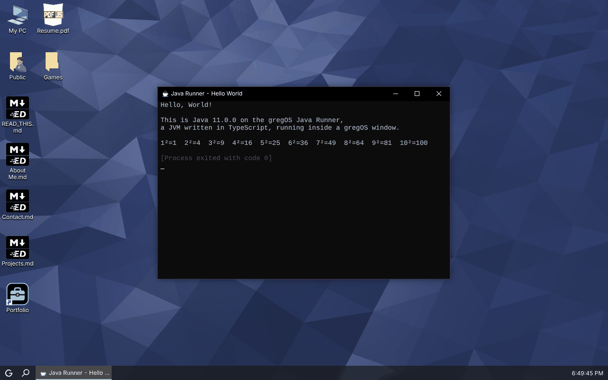

*18:49: First Hello World run in a gregOS window: the JVM prints to an xterm console.*

- **18:49** The Hello World jar runs in a gregOS window. Now scripting the full "double-click on the desktop" flow for the milestone screenshot.

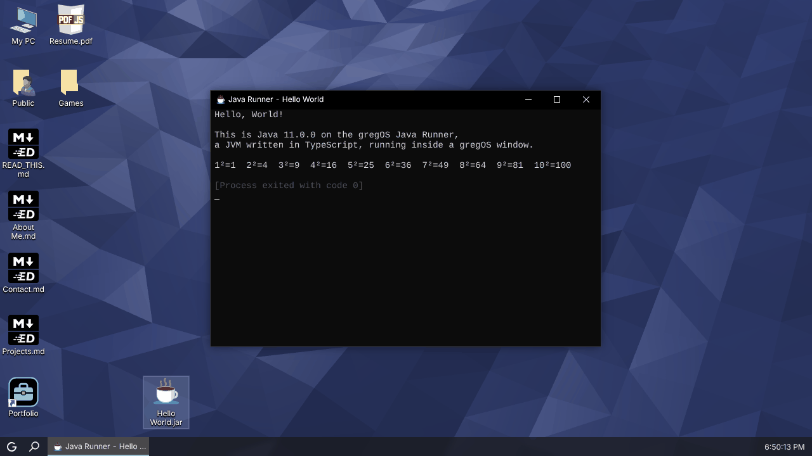

*18:50: Milestone 4's deliverable: the Hello World jar double-clicked on the gregOS desktop, printing in a Java Runner window.*

- **18:51** Both e2e specs pass locally (the console-log guard fails every e2e test in this container because of a Chromium built-in-AI warning; documented). Committing milestones 3–4.

<a id="step-4"></a>

## Step 4: Milestone 5: booting the game

*18:51 to 19:25*

The game's 54 MB jar was stripped of its desktop native libraries (38.5 MB
left) and placed in `Desktop/Games/Java` with a shortcut to the GPL source.
Run headless under Node, `DesktopLauncher.main` got through the launch
validator and into `Lwjgl3Application`.

From there the original LWJGL backend was replaced with the runner's own
Java classes in `components/apps/JavaRunner/java/gdx/` (application loop,
window, graphics, input, audio, files and preferences), compiled into
`public/System/JavaRunner/gdx.jar` and placed ahead of the game jar on the
class path. Behind them are JavaScript natives: a GL20 to WebGL2 bridge
(client-side vertex arrays, and an offscreen default framebuffer so frames
split across scheduler slices never show half-drawn), a PNG decoder and
`Gdx2DPixmap` natives, and a FreeType replacement built on the repo's existing
opentype.js with a small coverage rasterizer.

The game then booted headless in Node and rendered frames continuously
against a mock GL, about 37 ms per frame for the title scene. Two bugs worth
noting: instance-method natives receive `this` as their first argument (the
GL natives weren't skipping it), and font loading needed `RandomAccessFile`
and `FileChannel`, which were added to the runtime.

### Status messages and screenshots

- **18:51** Milestone 5: booting Shattered Pixel Dungeon. First, the stripped jar and a first run under Node to see where it stops.
- **18:53** The game reaches `Lwjgl3Application`. Checking which original libGDX backend classes are pure Java (keep) versus which touch LWJGL (replace).
- **18:58** Picking back up on milestone 5: I'm replacing the game's LWJGL desktop backend with Java classes backed by browser natives, starting with getting the game to boot headless under Node.
- **18:59** Still on milestone 5: mapping exactly which backend APIs the game calls so the replacement backend stays small.
- **19:00** Working on the game files now: checking how the existing Desktop Games folder ships ROMs so the game jar can sit alongside them with its GPL source link.
- **19:01** Game jar is in place under Desktop/Games/Java with a GPL source shortcut. Now writing the replacement libGDX backend classes.
- **19:02** Writing the Java side of the browser backend now (application loop, window, graphics, input, audio, GL bindings).
- **19:04** Writing the input class next (keyboard/mouse events from the browser feed libGDX's event queue).
- **19:06** Backend jar compiles (16 classes). Next: the JavaScript natives behind it, starting with WebGL.
- **19:09** Next is the biggest native piece: the GL20→WebGL2 bridge, including client-side vertex arrays and an offscreen default framebuffer so frames split across scheduler slices never show half-drawn.
- **19:11** Now the image side: a PNG decoder and the Gdx2DPixmap natives.
- **19:14** Writing the FreeType replacement next: font parsing via the opentype.js dependency the repo already has, plus a small area-coverage rasterizer and border stroking.
- **19:16** Now wiring it into the Node runner so the game can boot headless.
- **19:17** The game boots through `create()` into its first render. Two issues: gamepad natives (expected) and a shader status check reading 0. Debugging the latter.
- **19:17** Found it: instance-method natives receive `this` as the first argument, and the GL natives (instance methods on WebGL20) weren't skipping it. Fixing.
- **19:19** Font loading needs `FileHandle.map()`, which uses `RandomAccessFile` and `FileChannel`. Adding small runtime implementations of both.
- **19:22** The game now runs past font loading (output was just buffered). Re-running with direct logging to see how far it gets.
- **19:22** While that runs, I'll start the browser side (canvas, input and audio plumbing in the app).
- **19:23** The game now boots headless in Node and renders frames continuously (~37 ms/frame against a mock GL, title scene). Linting the new code before committing.
- **19:23** Fixing the remaining lint findings by hand.
- **19:24** Lint and typecheck are clean. Quick re-check that the game still boots after the lint fixes, then committing.
- **19:25** Updating DESIGN.md and PROGRESS.md before committing this milestone step.

<a id="step-5"></a>

## Step 5: Milestone 6: the libGDX bridge in the browser

*19:27 to 19:50*

The page side (`components/apps/JavaRunner/gdx/page.ts`) forwards DOM input
as libGDX key codes and pointer events, forwards resize and focus, plays
audio through Web Audio on the main thread, and handles cursor and clipboard
commands. The canvas is transferred to the worker as an `OffscreenCanvas`.

The first browser run exposed a gregOS file-system quirk: `stat` reports a
missing path as a file of size -1, and `readFile` returns empty data, so the
bridge checks `exists` first. After that fix, **the welcome screen rendered
inside a gregOS window**. The game's fullscreen request was mapped to
maximizing the gregOS window, since real browser fullscreen needs a user
gesture.

Clicking through then pulled in more of the class library: the time-zone
database (now served from `java.home/lib` inside the runtime jar) and a small
`SecureRandom` backed by `crypto.getRandomValues`. Hero selection, the JPEG
splash art, the intro and floor 1 all worked.

### Status messages and screenshots

- **19:27** Committed and pushed (`20c25b8`). Now the page side: canvas in the window, input/resize/focus forwarding and audio. Checking how other gregOS apps manage canvases, titles and window sizes.
- **19:27** Writing the page-side bridge (`gdx/page.ts`): DOM input → libGDX key codes, resize/focus forwarding, Web Audio playback and cursor/clipboard commands.
- **19:28** Now the message types and the worker.
- **19:28** Now the session (main thread) wiring.
- **19:29** Now the React hook: create the canvas for libGDX jars, hide the console, and route title/size/exit.
- **19:30** Clean. Now styling for the canvas mode.
- **19:30** Starting the dev server to try the game in the real app.
- **19:30** An earlier dev server is still running on port 3000 (hot reload picks up changes). Launching the game in headless Chromium.
- **19:34** Real-filesystem behaviour differs from Node: files that don't exist seem to read as existing-but-empty. Checking the gregOS fs `stat` wrapper.
- **19:34** gregOS's `stat` resolves missing paths as a size −1 file (and `readFile` as empty), so the bridge must check `exists` first. Fixing the bridge.


*19:35: First time Shattered Pixel Dungeon rendered in the browser: the welcome screen inside a gregOS window, with FreeType text, textures, the JPEG splash and animated fire.*

- **19:35** **The Shattered Pixel Dungeon welcome screen renders inside a gregOS window**, with FreeType text, textures, the JPEG splash and animated fire. Saving the screenshot and committing.

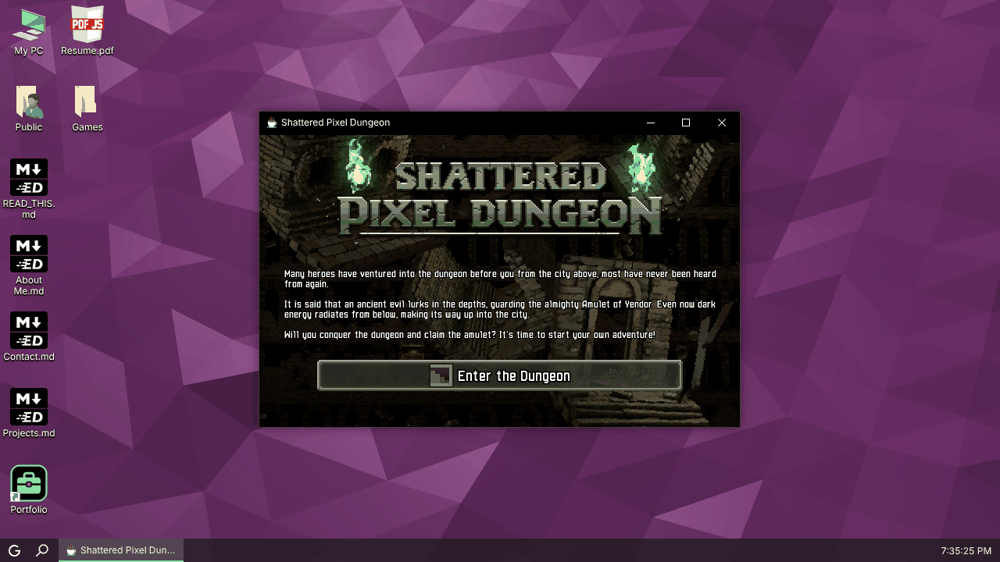

*19:35: The same welcome screen, saved as the milestone screenshot.*

- **19:36** Next: interaction. The game asks for fullscreen at startup; checking when it does that to decide how to map it onto the gregOS window.
- **19:36** Default is fullscreen=true, so I'll map game fullscreen onto maximizing the gregOS window (real browser fullscreen needs a user gesture).
- **19:36** Writing a reusable Playwright driver that runs a list of actions (wait, click, key, screenshot) against the game.
- **19:38** Input works: the click reached the hero selection scene, which then needs the time-zone database (`tzdb.dat`). Adding it to the runtime jar and serving `java.home/lib` files from there.
- **19:39** Time-zone data now ships in the runtime jar. Quick Node check, then back to the browser run.

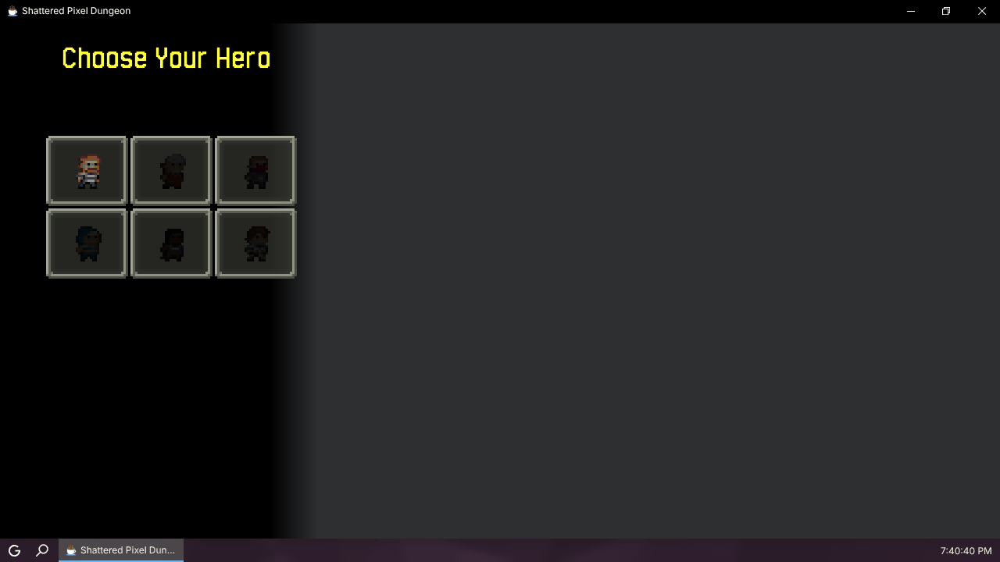

*19:40: First click worked: hero selection. The empty area turned out to be the normal unselected state, not a broken JPEG.*

- **19:40** Hero selection works. The splash art behind it is the grey JPEG fallback, so JPEG decoding in the worker is failing. Investigating.
- **19:41** Decoding works in a plain worker, so the failure is in my path. Adding temporary diagnostics.
- **19:42** No JPEG load was attempted at all, so the grey area is probably just the unselected state. Clicking a hero to check.

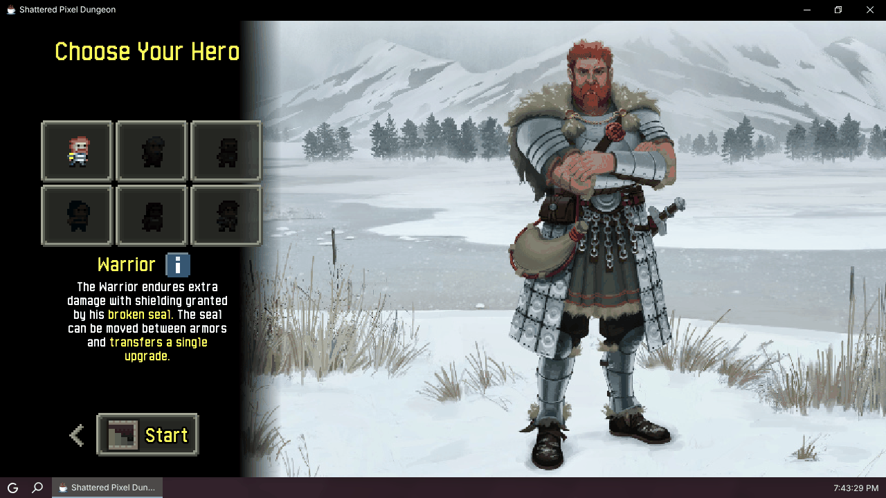

*19:43: Selecting the Warrior shows the JPEG splash art, decoded in the worker with createImageBitmap.*

- **19:43** JPEG splash art works. Removing the debug lines and pressing **Start** to enter the dungeon.
- **19:45** SPD's `MissileWeapon` uses `SecureRandom`, whose JDK version drags in the security provider framework. Writing a small own `SecureRandom` backed by `crypto.getRandomValues`.

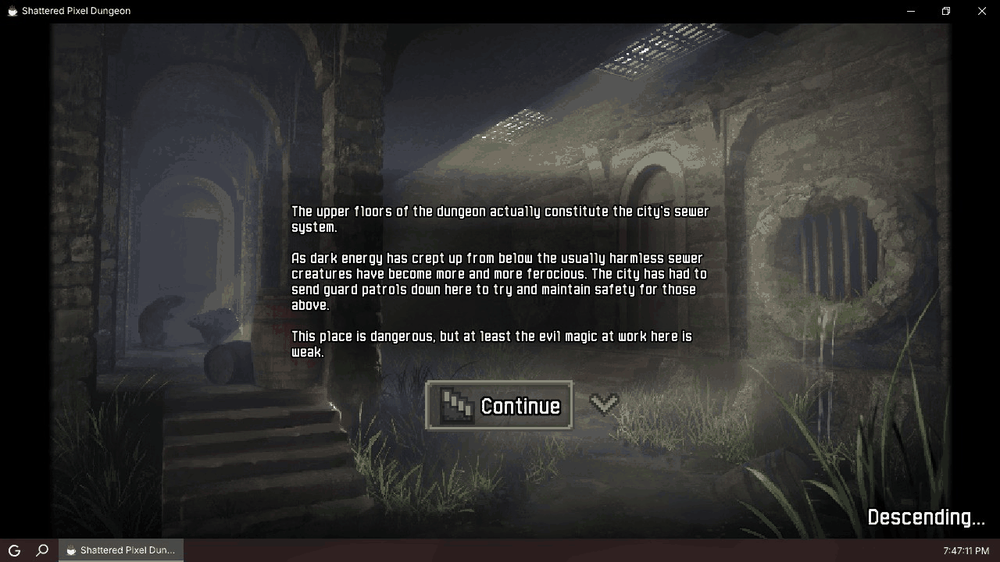

*19:47: Pressing Start: the game's intro text while floor 1 generates ("Descending...").*

- **19:47** The run is starting ("Descending…" while the first floor generates). Continuing into the dungeon.


*19:49: Floor 1 rendered for the first time, with the tutorial guide (red book) in the room.*

- **19:50** The PNG decoder matches PIL on all 148 images (one benign 1-bit difference), so that's not it. Taking a longer look: waiting, moving the hero with the keyboard, and logging failed requests.

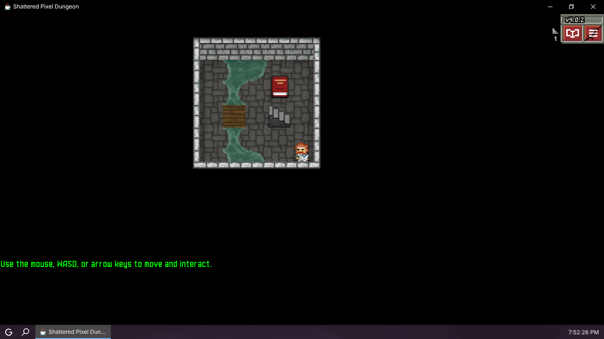

*19:52: Floor 1 after moving the hero with the keyboard (while checking the PNG decoder against PIL).*


<a id="step-6"></a>

## Step 6: Milestone 7, first pass: saves, seeds and speed

*19:56 to 21:07*

Milestone 7 needs a run that can be played, saved and continued by script.
Several things were tried and checked here:

- **Saves.** After a close and reopen the welcome screen came back. The save
  files were all written; the game shows that screen until its first-run
  `intro` flag is cleared, which is normal behaviour. A second launch crashed
  on a missing `javax.net.ssl.SSLProtocolException` (the news check
  references it), so those classes were shipped too.
- **A fixed seed** would have made the playthrough deterministic. A seed
  search tool was written, but the game's Custom Seed option stays locked
  until you win a game, so that path was dropped.
- **Speed.** Profiling showed 44% of the time in the `Frame` constructor,
  caused by `Array.from({ length })`. Plain preallocated arrays more than
  doubled speed: about 16 ms per frame, down from 37.
- **Log-driven waits.** The script was clicking before floors finished
  generating, so it now waits for the game's own log lines (forwarded from
  the worker) instead of fixed delays.

### Status messages and screenshots

- **19:56** Next is milestone 7's scripted playthrough. A fixed dungeon seed would make it deterministic; checking whether the custom-seed option is available on a fresh profile.


*20:00: After closing and reopening, the first-run welcome screen appeared again. Saves were fine; the game keeps showing it while its `intro` flag is set.*

- **20:00** After close and reopen the game shows its first-run welcome screen again, so settings/saves didn't persist. Checking what actually got written to Saved Games.
- **20:03** Saves are written (settings.xml, game1/game.dat, depth1.dat, journal). So the problem is on the read side after reopening. Logging fs replies on the second launch.
- **20:09** Settings persist correctly. The welcome screen reappears because SPD keeps showing it while its first-run `intro` flag is still set, which is real SPD behaviour. Finding what clears that flag.
- **20:14** 44% of time is in the `Frame` constructor. Looking at it.
- **20:15** `Array.from({ length })` in the hot path is very slow. Replacing it with plain preallocated arrays.
- **20:15** That alone more than doubled speed: ~16 ms/frame in Node (was ~37) and first frame at 4.9 s (was 9 s). `pump` shows 10% self time; checking it.
- **20:16** Next, looking at the interpreter's main loop for further cheap wins before deciding on the JIT design.
- **20:19** No seed in the first 300 has the exit in view from the start. Widening the search and printing the shortest entrance→exit path instead.
- **20:19** Every seed yields the same level, so `Dungeon.init` isn't reading the custom seed setting. Checking how it picks the seed.
- **20:20** Seed search is close: the BFS stops at doors. Treating door tiles as passable.

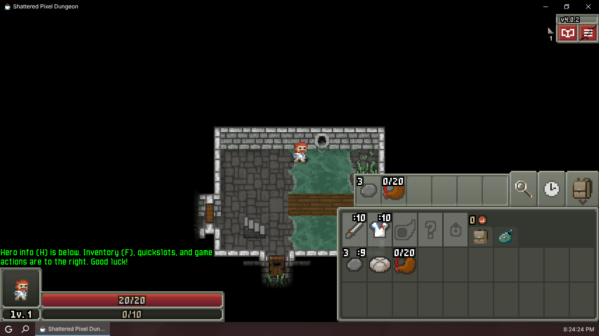

*20:24: Floor 1 after the tutorial: the full HUD (health, quickslots, inventory pane) is revealed.*

- **20:28** After reopening, the title scene crashes on `javax.net.ssl.SSLProtocolException` (the news/update check references it when the request fails). Finding the reference.

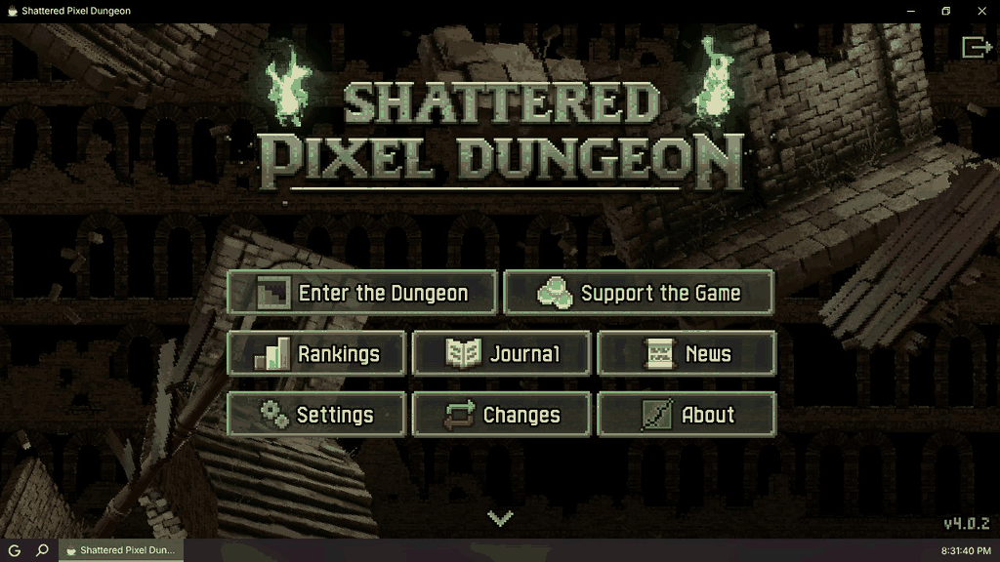

*20:31: The full title screen on a second launch, after shipping the missing SSL exception classes.*

- **20:31** The full title screen now loads on the second launch (the news/update check fails cleanly since there's no network bridge). Clicking **Enter the Dungeon** to continue the saved run.

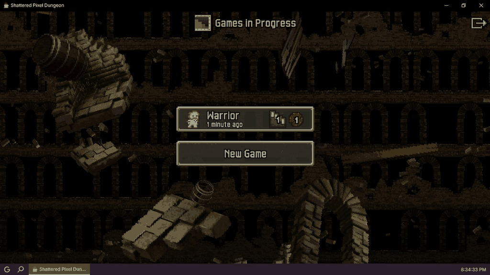

*20:34: "Games in Progress" lists the saved Warrior run.*

- **20:34** For the descend step I'll use a fixed seed and a precomputed path. Checking whether hero selection exposes the seed option now that the intro is done.


*20:37: A later reopen showed the welcome again: that run's `intro=false` setting hadn't been written yet because the script clicked too early.*

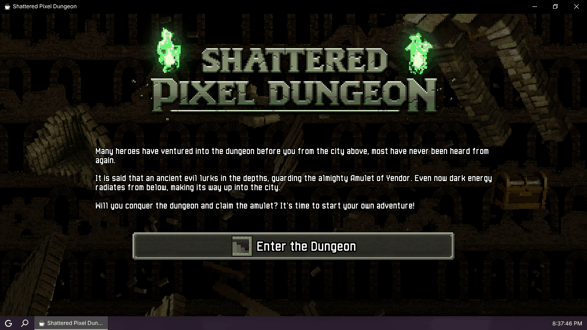

*20:38: Same symptom, before switching the script to wait on game log lines.*

- **20:38** The reopened game showed the first-run welcome again this time, so the `intro=false` setting sometimes isn't persisted. Logging the settings writes to see why.
- **20:40** That run clicked too early: the floor was still generating. The script needs to wait on game log lines rather than fixed delays. Adding a `waitLog` action.
- **20:42** Log-driven waits make the tutorial deterministic and `intro=false` persists. Now checking hero selection for the seed option after a completed intro.

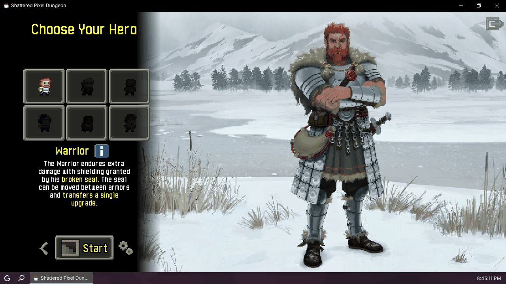

*20:45: With the intro completed, hero selection shows a game-options gear next to Start.*

- **20:45** A game-options gear now appears next to Start. Opening it to find the seed entry.

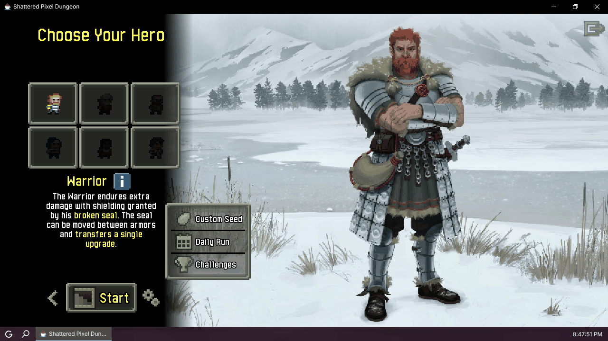

*20:47: The game options: Custom Seed, Daily Run, Challenges.*

- **20:48** "Custom Seed" is there. Updating the seed search to match a post-intro run (`intro=false`, which likely changes floor 1's generation) and to output a walkable path.

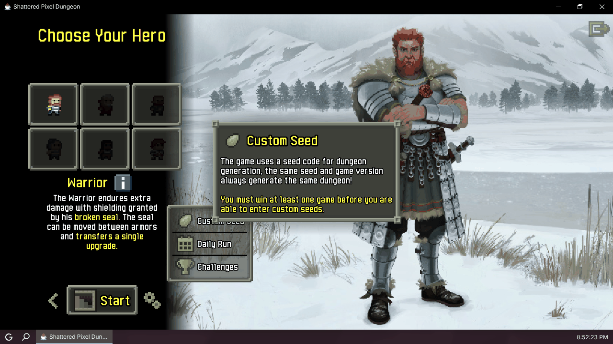

*20:54: Custom seeds are locked until you win a game, so a fixed-seed playthrough was not possible.*


*20:54: Same dialog, confirming the lock.*

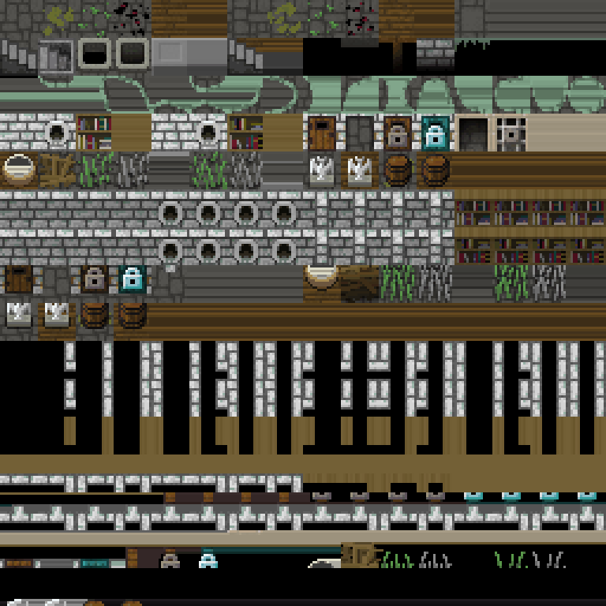

*20:55: The sewer tileset, inspected for colours unique to the exit stairs.*

- **20:55** The tileset has colours unique to tile (1,1), likely the down stairs. Checking which stairs tile the hero spawned on in an earlier screenshot.
- **21:07** While the playthrough runs, checking its intermediate screenshots.

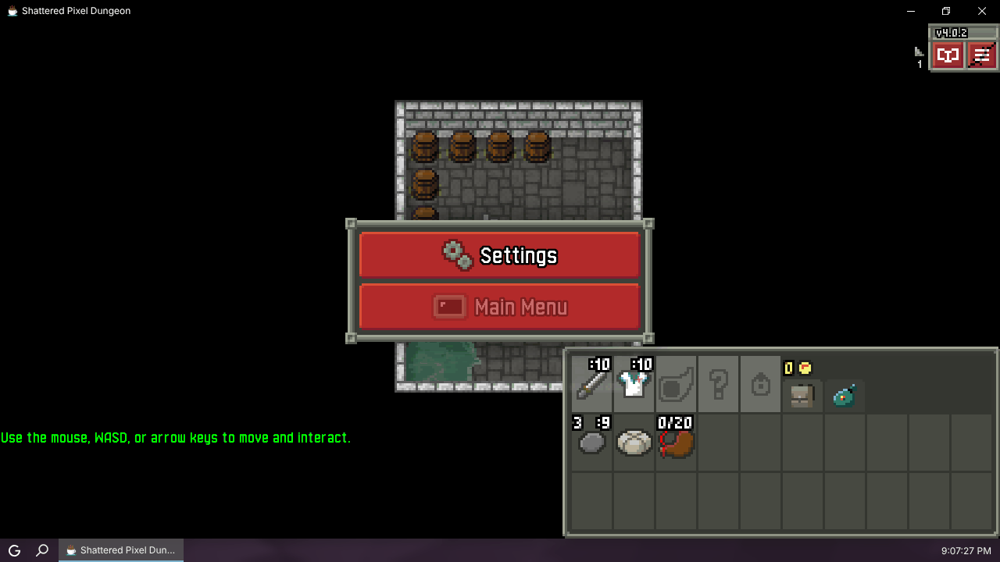

*21:07: First scripted playthrough: a stray Escape opened the in-game menu.*

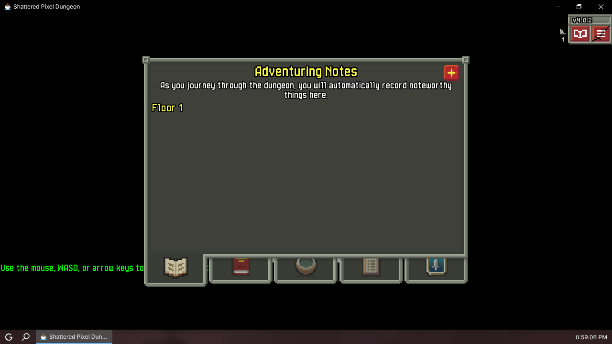

*21:07: The journal (Adventuring Notes), opened with J as part of the tutorial.*

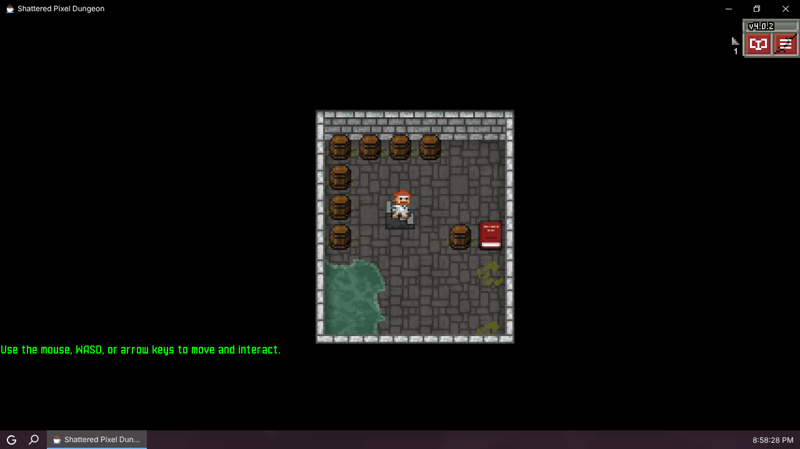

*21:07: The tutorial room at the start of a scripted run.*

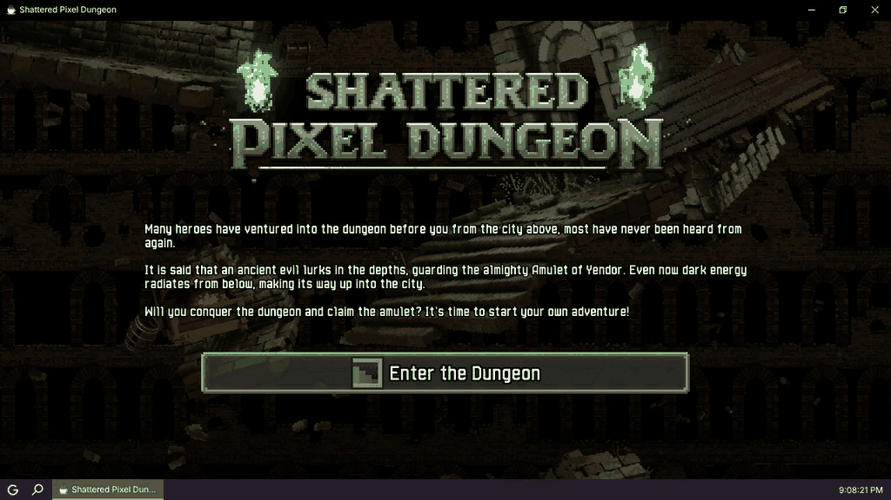

*21:08: The script ended up back at the title screen after its exploration wandered out of the game.*


<a id="step-7"></a>

## Step 7: Milestone 8: a JIT compiler

*21:13 to 21:50*

To get further than the interpreter allowed, hot methods are compiled from
bytecode to JavaScript functions (`components/apps/JavaRunner/jvm/jit.ts`):

- A method is compiled after a few interpreted calls, or when one of its
  loops runs long enough (on-stack replacement at backward branches).
- Compiled code never blocks. When it would have to wait (class
  initialization, a contended monitor, file I/O, a very deep call chain, or
  the end of the thread's time slice), it throws a `Suspend` that turns each
  compiled activation back into an ordinary interpreter frame. The
  interpreter can hand frames back to compiled code at block starts.
- Virtual and interface calls use per-site inline caches. Exceptions,
  backtraces and `getCallerClass` see compiled frames through per-thread
  arrays.
- The conformance suite runs twice: interpreted, and with every method
  compiled on first call.

Bugs along the way: an OSR exit used `break` inside a `switch` (fixed with a
labeled break), and a generated function was named `delete`, a reserved word
(fixed with a prefix). Result: **about 3.8 ms per frame** in Node, down from
16 ms (and 37 ms originally). In-game frames average about 4 ms; in Node the
game is now mostly idle between frames.

### Status messages and screenshots

- **21:13** First playthrough run: start and move passed; the tutorial pickup failed, which cascaded. Re-running with the retry fixes in the background while I start on the JIT.
- **21:13** JIT design time. Reviewing the interpreter's structure so compiled code can reuse its semantics.
- **21:17** Checking which non-generator natives push Java frames, since compiled code must handle that case.
- **21:17** Natives only block through generators, and termination is the one other case compiled code must notice. Checking the instruction-walking helpers I can reuse.
- **21:19** Moving the interpreter's resolution and error helpers into a shared module so the JIT can use them without an import cycle.
- **21:20** Refactor done, tests green. Checking the playthrough run before writing the compiler.

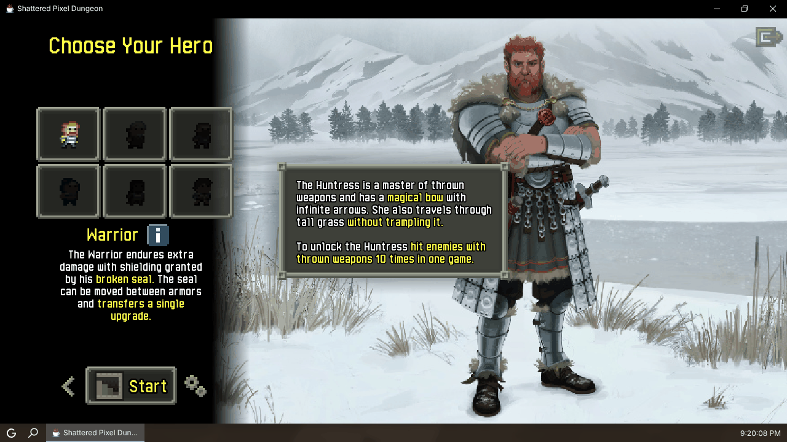

*21:20: Another early run wandered into hero selection; this is when per-step screenshots and click logging were added.*

- **21:20** The exploration loop wandered out of the game (ended at hero select). Adding per-step screenshots and click logging so I can see what happened; it'll run in the background while I write the compiler.
- **21:20** Writing the compiler module. First moving `pseudoMethod` into the shared module too, since the JIT needs it for monitor-entry generator frames.
- **21:25** Now wiring the JIT into the VM: thread/method fields, the compiled-code boundary in the interpreter, on-stack replacement at hot backward branches, and backtraces that include compiled frames.
- **21:25** Now applying the integration edits across types, vm, interpreter and the backtrace natives.
- **21:25** The OSR exit used `break` inside a `switch`, which only leaves the switch. Switching to a labeled break out of the instruction loop, and updating the `goto` site too.
- **21:26** Typecheck passes. Checking the finished playthrough run before testing the JIT.
- **21:31** The compiled run hangs. Debugging a single program through the Node runner with the JIT forced on.
- **21:31** (My `pkill` matched its own shell again; avoiding that pattern from now on.) Redoing the runner edit.
- **21:32** Arithmetic now matches with everything compiled. Running all conformance programs through the JIT.
- **21:33** Good start: 7 of 11 pass compiled. Looking at the failures.
- **21:33** Only a reserved-word function name (`delete`) left. Prefixing generated function names.
- **21:34** All 29 tests pass, including the full conformance suite with every method compiled. Now measuring the game with the JIT at its default threshold.
- **21:34** The JIT is a big win: about **3.8 ms per frame** in Node (16 ms before, 37 ms originally), and the title scene is now mostly idle time. Linting and running the full test suite before committing.
- **21:36** Tests pass and the game still runs (~3.9 ms/frame). Committing the JIT.
- **21:36** Pushed. Now re-running the browser playthrough with the JIT to see speed and debug the exploration heuristic.
- **21:36** While that runs, documenting the JIT design decisions.
- **21:36** While the run proceeds, updating PROGRESS.md to the current state.
- **21:37** Just started stepping. Waiting for step results.

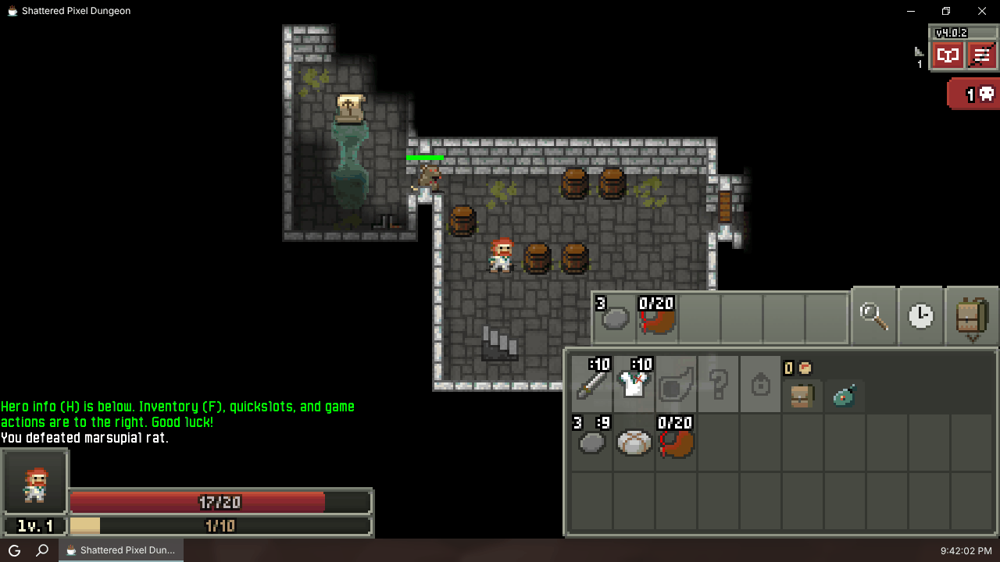

*21:46: Exploration fighting a marsupial rat; the green bar above a noticed enemy is what the script clicks.*

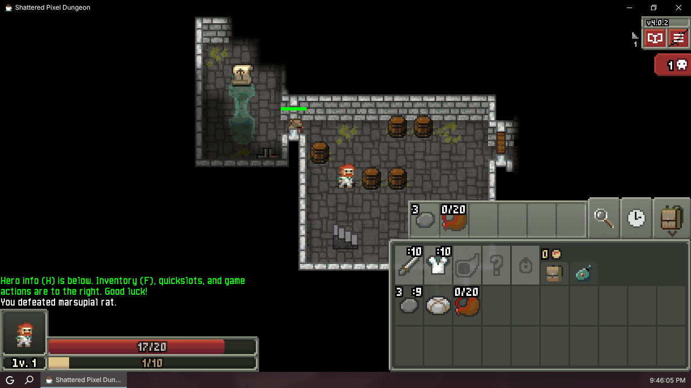

*21:46: The end of an exploration run without finding the stairs.*

- **21:50** The previous run was still finishing and shared the log file; the new run is now running alone. Waiting for it.

<a id="step-8"></a>

## Step 8: Milestone 7, second pass: the playthrough script

*22:10 to 22:58*

With the engine fast enough, attention moved to
`scripts/javaRunner/shattered.cjs`, which plays the game in headless Chromium
using clicks, keys and screenshots only. Along the way it learned to:
find the guide anywhere outside the top-right menu, skip targets that leave
the view unchanged, attack enemies by their green health bars, and close the
window and reopen it to test saving.

**Save and continue passed** at 22:45: "You return to floor 1 of the
dungeon." Every step passed except descending the stairs, because the
explorer never found them within its step budget.

### Status messages and screenshots

- **22:10** The tutorial step failed this run. Looking at the screenshots around it.

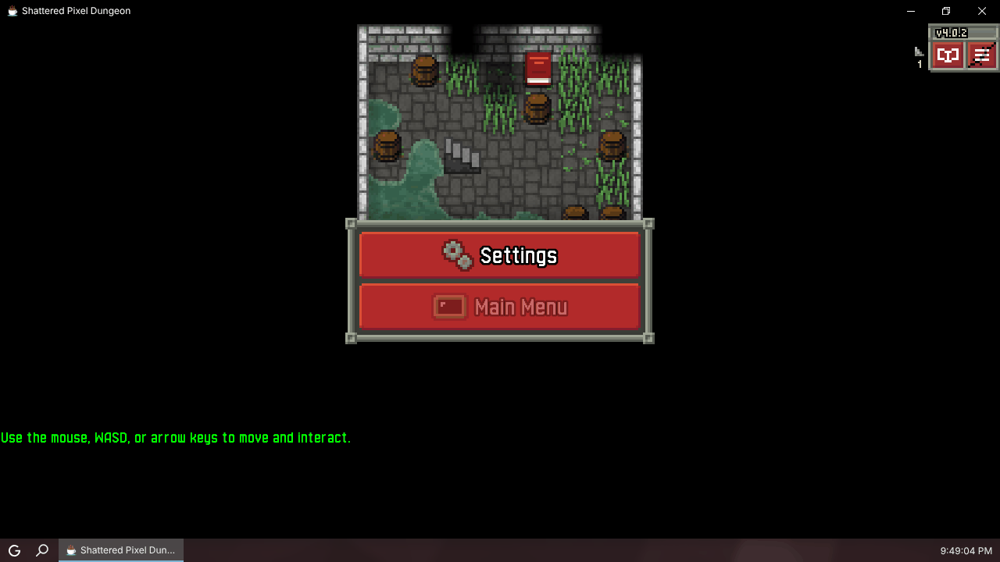

*22:10: Tutorial failure: the guide sat at y=87 and the colour search ignored everything above y=100.*

- **22:10** The guidebook was at y=87 and the colour search ignored everything above y=100, so it was never clicked. Restricting the exclusion to the top-right menu instead, then re-running.
- **22:10** While that runs, committing the script and doc updates.
- **22:11** While waiting, making exploration resilient: if an action doesn't change the screen, that target is blacklisted until the view changes.

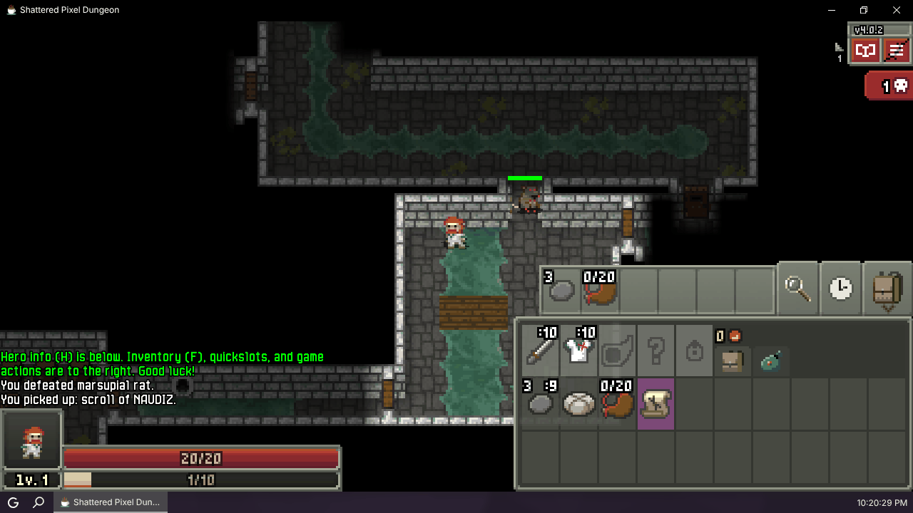

*22:21: An enemy's green health bar, which the script detects as a solid run of (0,238,0).*

- **22:21** Health bars are (0,238,0). Adding an "attack visible enemy" step to the exploration loop.
- **22:32** (My wait loops were matching their own command lines via `pgrep -f`, which is why they never returned.) Checking the completed run.

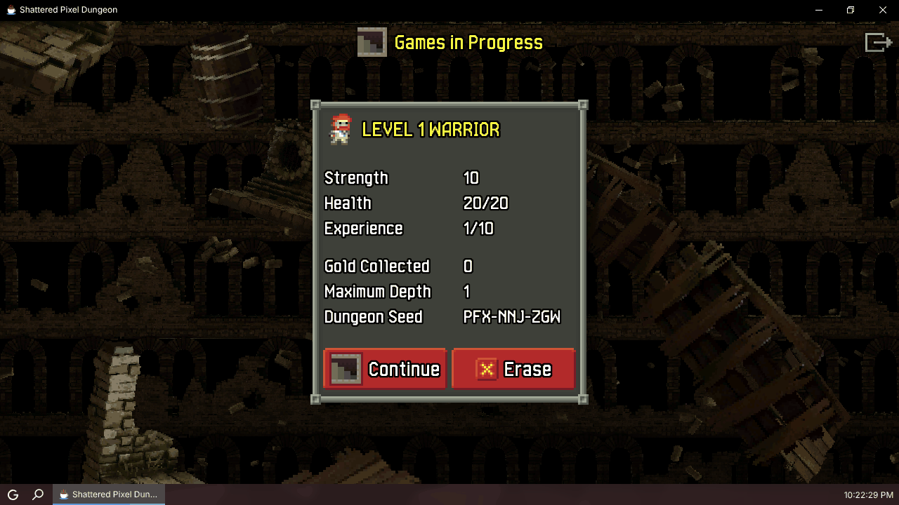

*22:32: "Games in Progress" details for the saved run, with the Continue button.*

- **22:32** While that runs, I'll add scripted input to the Node runner, so gameplay can be profiled headless at the same 1280×660 layout as the browser.
- **22:35** The Node harness reaches floor 1 with the same coordinates, and in-game frames average about 4 ms. Profiling the whole sequence (boot, level generation, play) to find the next hotspots.
- **22:36** In Node the game is now mostly idle between frames; codegen is about 5% of CPU. The remaining cost in the browser is software WebGL and messaging. Checking the browser run.

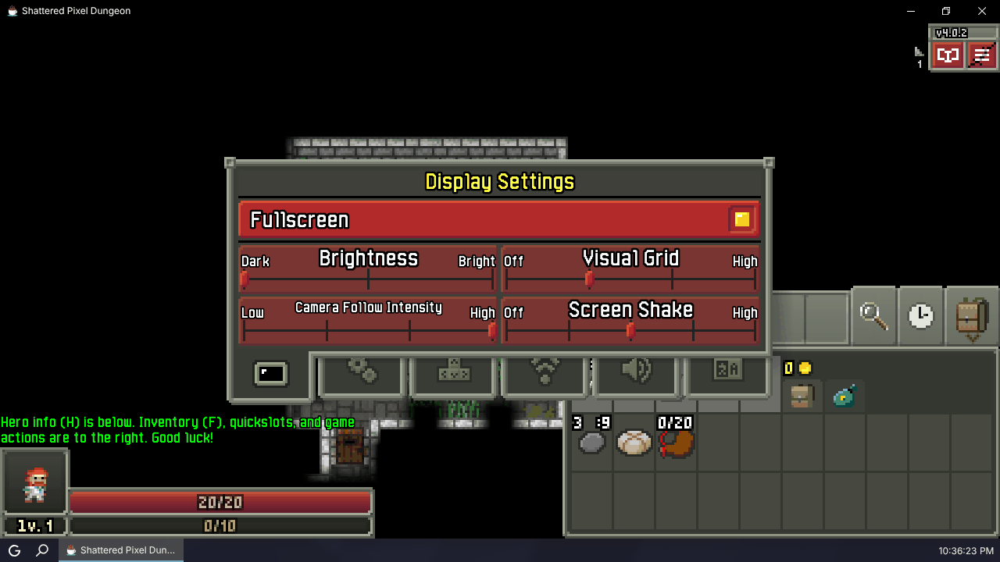

*22:36: A stray click opened Display Settings; the script learned to close windows by clicking outside them.*

- **22:45** **Save and continue now passes.** Confirming the screenshot.

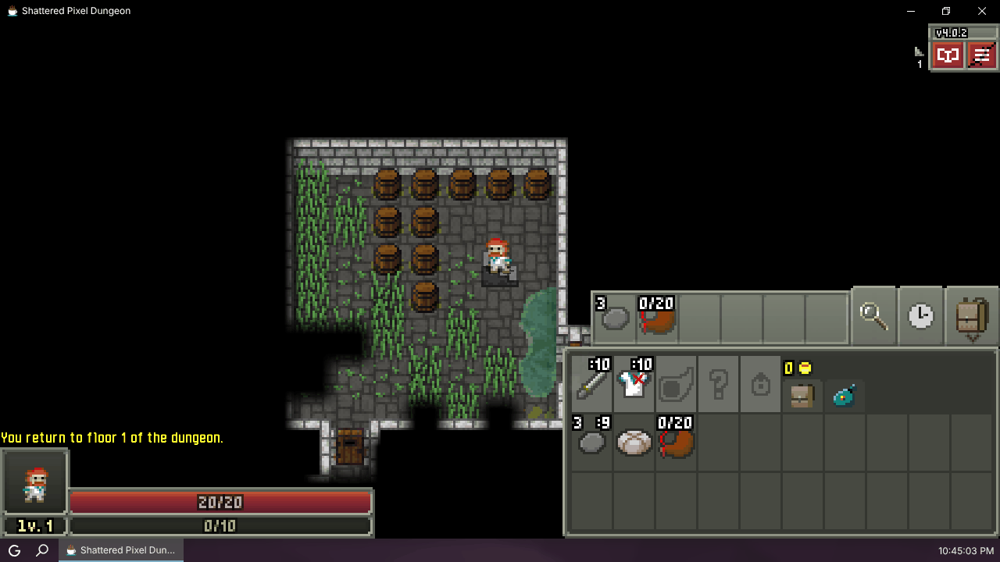

*22:45: Save and continue passes for the first time: "You return to floor 1 of the dungeon."*

- **22:45** Reload works: "You return to floor 1 of the dungeon." Saving that screenshot for the docs and running the playthrough again with the window-closing fix.
- **22:46** While waiting: caching each buffer class's element size instead of walking the class chain on every GL buffer call.
- **22:46** Updating the rest of PROGRESS.md while the run continues.

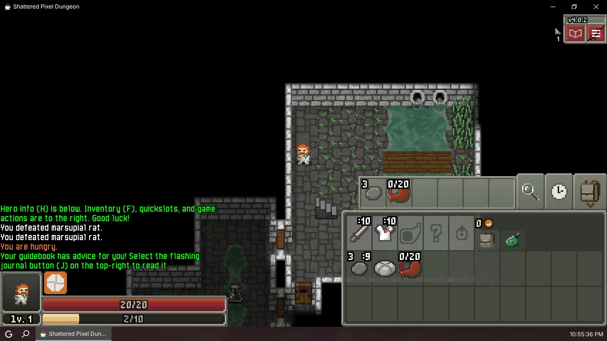

*22:57: A later run exploring while the hero gets hungry.*

- **22:57** While that runs, checking repo-wide lint and the full jest suite.
- **22:58** Lint and the full test suite (44 tests) pass. Waiting on the playthrough.

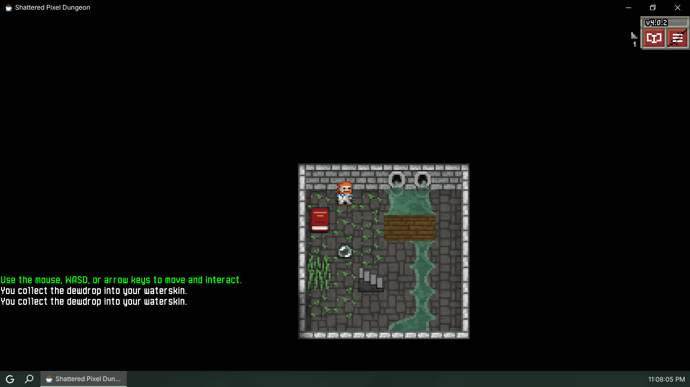

*23:09: A run stuck in a room with no visible doors. Investigation showed this is intended: floor 1's entrance doors stay hidden until the tutorial guide is read.*


<a id="step-9"></a>

## Step 9: Descending the stairs: teaching the script to explore

*23:09 to 00:55*

Getting the hero to the stairs was the longest single problem, and almost all
of it was about reading the screen, not about the JVM:

1. **A room with no doors.** One run was stuck in a room with no exits.
   Before suspecting the JVM's level generator, the game's source showed the
   rule: on floor 1 the entrance doors stay hidden until the tutorial guide
   has been read. The guide had spawned out of sight, so the script now walks
   around until it sees it.
2. **The HUD hides the map.** The inventory pane covers much of the screen,
   so the script zooms out, first to 32-pixel tiles and then all the way to
   16.
3. **An offline harness** let the screen classifier be tuned against saved
   screenshots in seconds instead of 15-minute runs. Overlays show what it
   sees: blue for unexplored, green for floor, orange for doors, red for
   frontier.
4. **Tiles from colours.** Walls are neutral grey and sewer floor slightly
   warm; door frames are a reddish grey; barrels share that grey but also
   have a purple shade doors never have; the exit stairs use two greys no
   other tile uses.
5. **Remembering where it has been.** The camera follows the hero, so the
   script estimates how far the view scrolled between screenshots and keys
   its memory by floor position. The tile grid offset is found where the
   screen splits into the most exactly repeated 16x16 blocks, which proved
   far more reliable than edge detection on pixel art.
6. **Better targets.** Doors count only if unexplored darkness lies beyond
   them in the right direction. The nearest target is chosen first, with
   fallbacks: travel to a distant floor tile, then floor near darkness, then
   random walking.
7. **Staying alive.** One run ended in a game over to a sewer snake, so the
   hero now rests with Z when health drops below 60%. Another run was blocked
   by the chasm prompt, so unexpected windows are closed with Escape.

### Status messages and screenshots

- **23:09** Checking why this playthrough missed the guide book and the visible stairs.

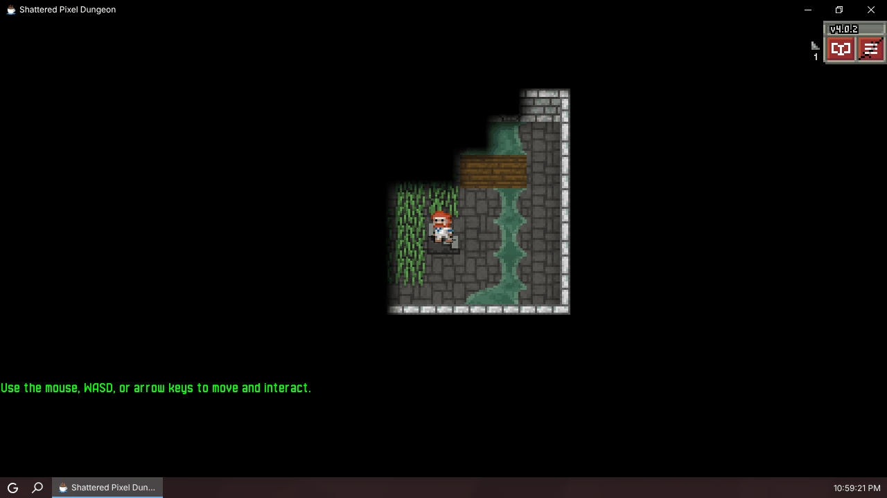

*23:09: The spawn view of that run: the guide was in the unlit part of the room, so the script never saw it.*


*23:10: Still in the closed room at the end of that run.*

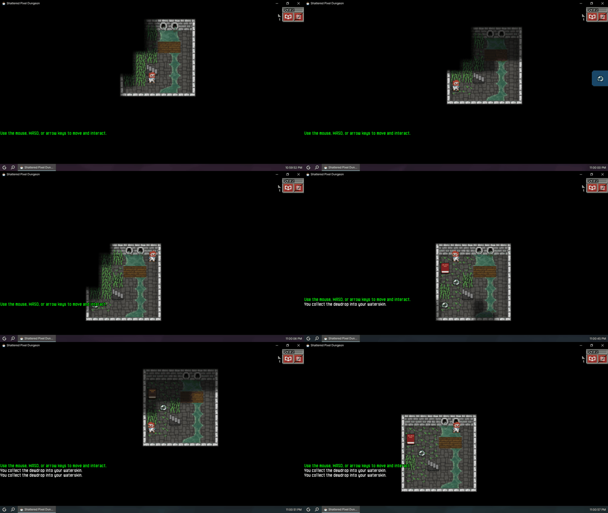

*23:10: Ten consecutive exploration frames from the closed-room run.*

- **23:10** Investigating why the start room in this run shows no visible doors (possible secret door vs. JVM bug).
- **23:11** Also making the explorer give up on a frontier tile after a few tries, since animated water defeated the "view unchanged" check.
- **23:11** Meanwhile, recording the finding in DESIGN.md/PROGRESS.md.

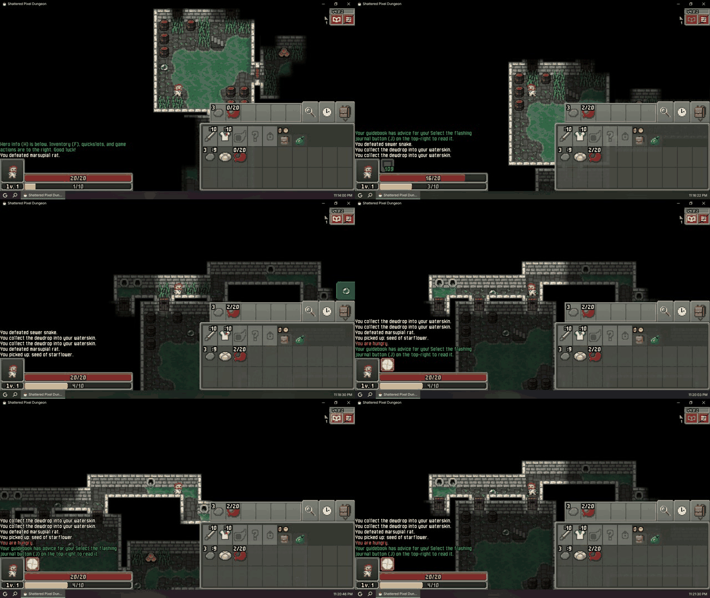

*23:21: At the default zoom the inventory pane covers much of the map, hiding stairs and doors.*

- **23:21** Tutorial now passes and fights happen; descend still fails because the HUD's inventory pane hides much of the map at the default zoom. Trying a zoomed-out view for exploration.

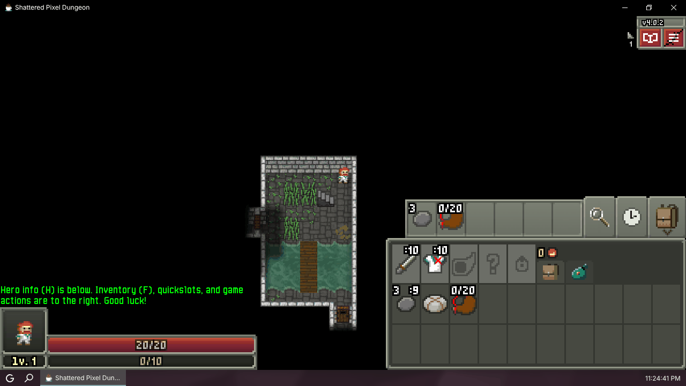

*23:24: First zoom-out test: 32-pixel tiles.*

- **23:24** The zoom-out works (32px tiles) and the explorer is heading for doors now. Waiting for the run to finish.

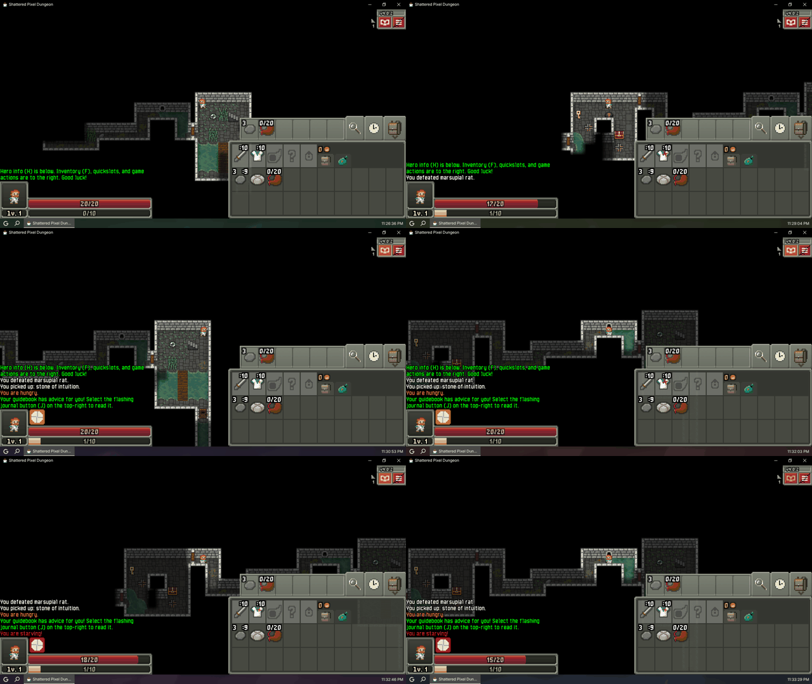

*23:33: Frames from a run where the hero walked the same corridors back and forth (farthest-target-first).*

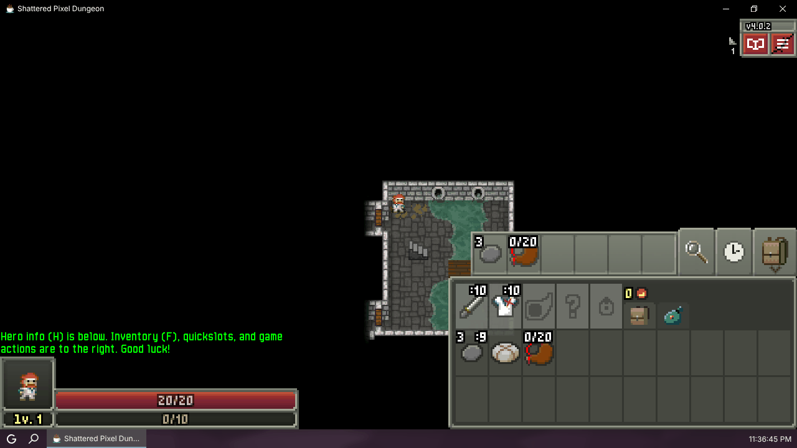

*23:44: The hero at the top edge of the map: the top wall next to off-map darkness looked like unexplored floor.*

- **23:45** Building a small offline harness to tune the screen classifier against saved screenshots instead of full 15-minute runs.

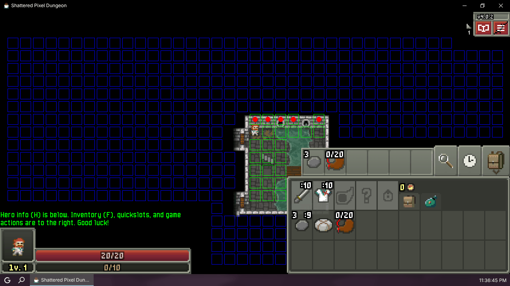

*23:46: The offline classifier overlay: blue = unexplored, green = floor, red dots = frontier targets (here wrongly on the top wall).*

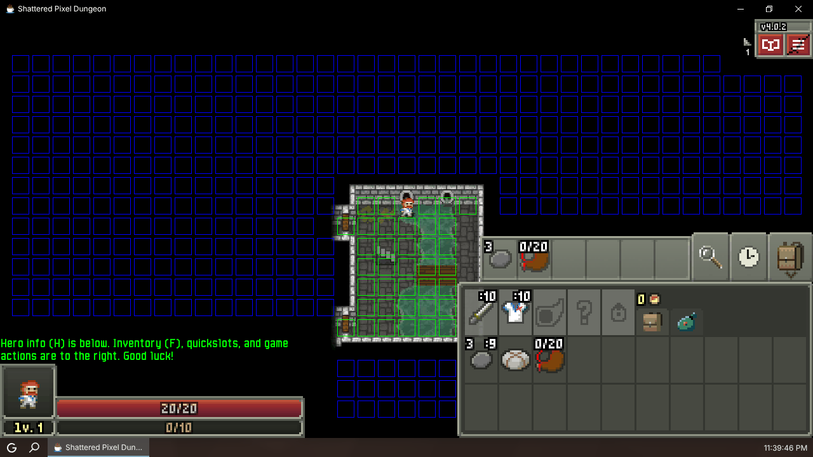

*23:46: Another overlay from the offline harness.*

- **23:46** Doors are the missing piece: the hero never walks through the side doors. Sampling door versus bridge colours to add a door detector.

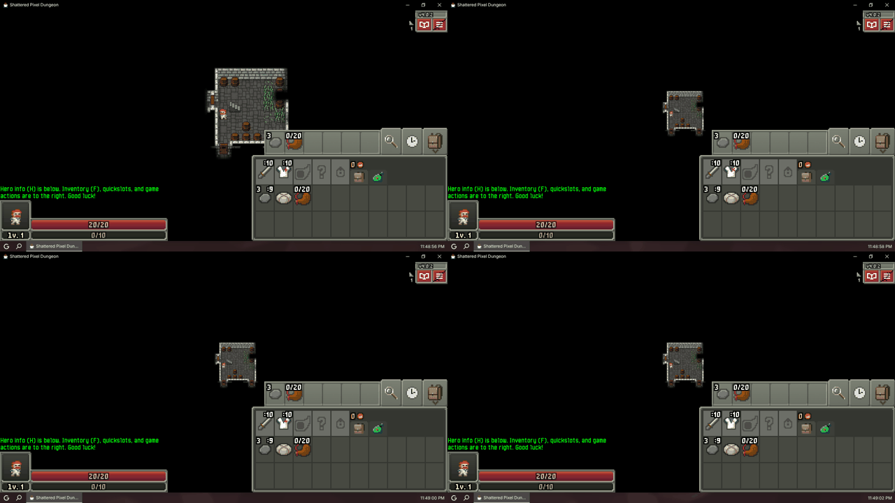

*23:49: Zoom levels: pressing minus twice reaches 1x, where tiles are 16 pixels.*

- **23:50** Q is "attack nearest enemy", so keeping it. Writing the new explorer now.
- **23:50** Now the rewrite of the analysis helpers:
- **23:51** Now the exploration loop itself:
- **23:51** Testing the classifier offline on the zoom-1 screenshot:

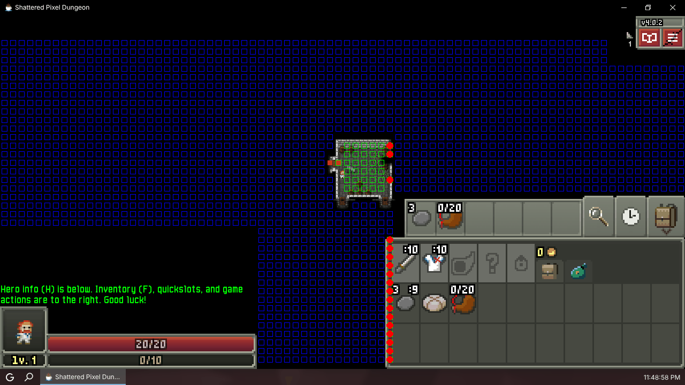

*23:51: The classifier at 16-pixel tiles, with doors (orange) detected.*

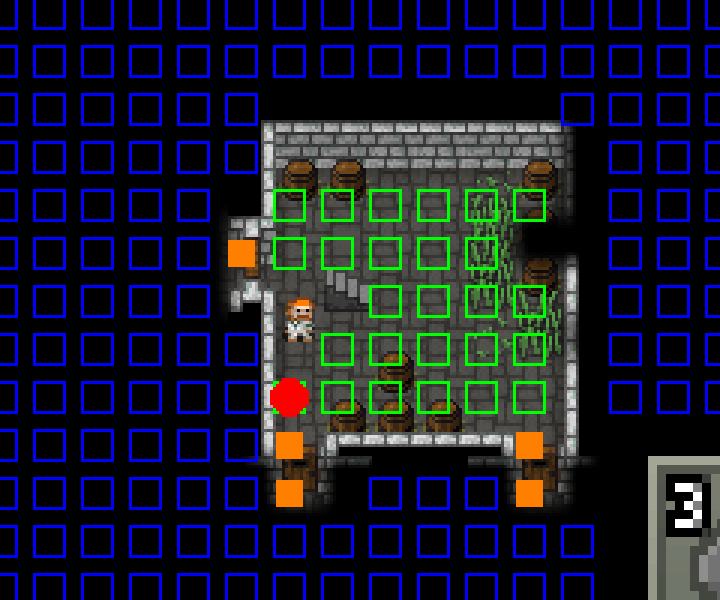

*23:52: Close-up after rejecting neutral-grey walls: floor, doors and one real frontier tile.*

- **23:52** Classifier looks right now (floor, doors, frontier). Checking the scroll estimator on a synthetically shifted screenshot:
- **23:52** The grid-offset estimate is unreliable at 16px tiles (pixel-art edges everywhere). Since the camera keeps the hero centred, the grid offset should be fixed; checking where the hero's tile sits.
- **23:53** Scroll estimation works on clean shifts. Running the full playthrough with the new explorer.

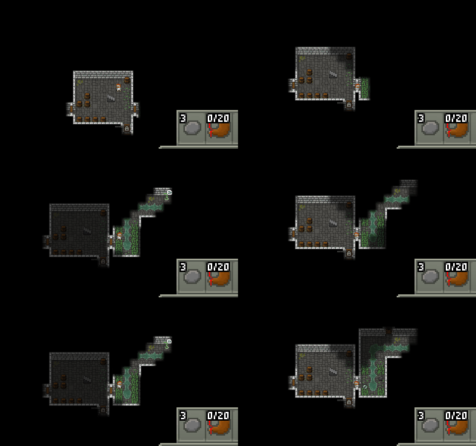

*23:55: Frames where the scroll estimate went wrong because the grid offset flipped by half a tile.*

- **23:55** The scroll estimate jumped wrongly between steps 3 and 4. Debugging offline on those two frames.
- **23:56** The per-frame grid offset flips by half a tile at this zoom. Since the camera keeps the hero centred, the true offset is constant, so I'll accumulate the edge energy across frames.

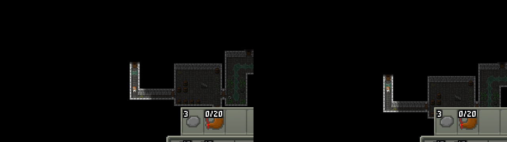

*23:57: Two frames whose shift was misjudged; used to debug the scroll estimator.*

- **23:57** The accumulated offset drifted (8 → 4) as frames were added. Inspecting the energy profile:
- **23:58** Offset now converges to a stable value and the scroll estimate for the failing pair is correct. Restarting the playthrough with the fixed code.
- **23:59** While it runs, recording the decisions in DESIGN.md.

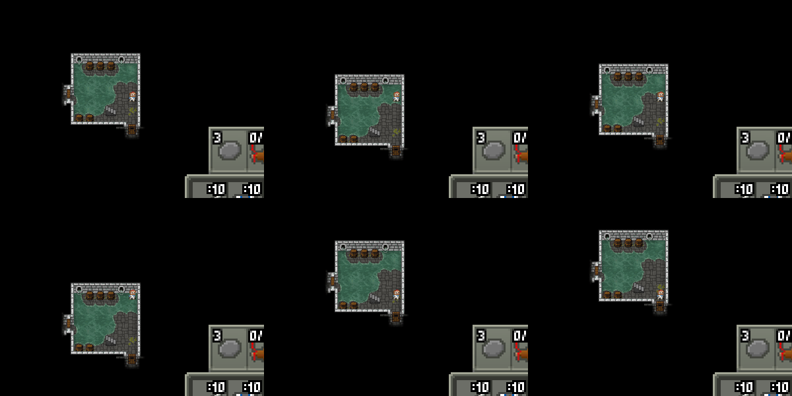

*00:01: The hero hugging a room's right edge because of a 4-pixel grid misalignment.*

- **00:01** The explorer hugs the room's right edge: thin side walls make the next tile look unexplored. I suspect the grid is also misaligned by 4px. Checking alignment visually at both offsets.

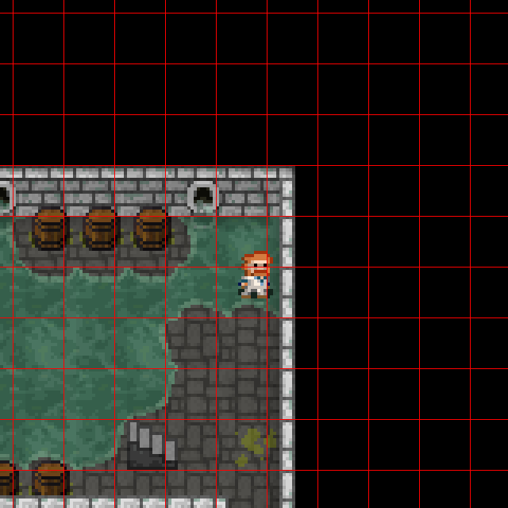

*00:02: Grid lines at the wrong offset: tiles straddle the grid.*

- **00:03** Consistent offset (8,12) across frames, ~1 s per frame. Verifying alignment visually:

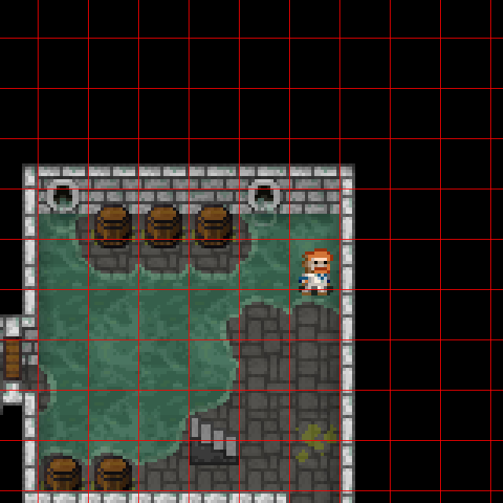

*00:03: Grid lines at the offset found by counting exactly repeated tiles: barrels, stairs and walls sit inside cells.*

- **00:03** Aligned properly now. Restarting the run with this version.

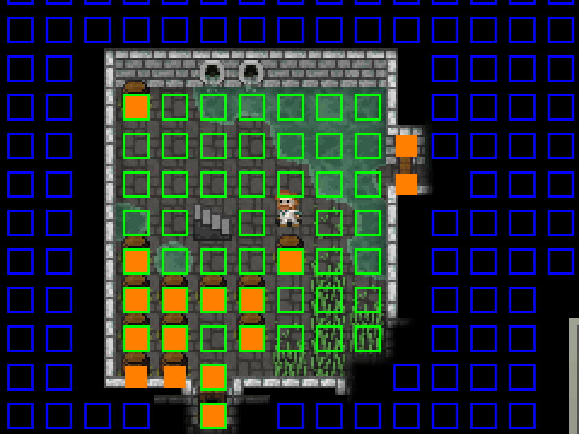

*00:06: Barrels detected as doors (orange) because they share the door frame's reddish grey.*

- **00:06** Barrels are being detected as doors. Comparing barrel and door palettes:
- **00:07** Barrels carry purple-ish shading that doors never have. Adding that as an exclusion:

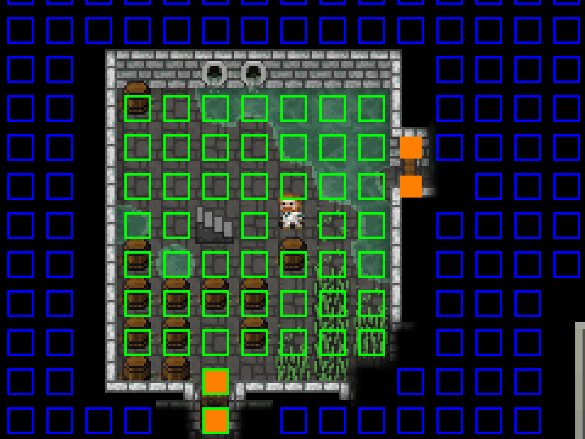

*00:07: After excluding barrels by their purple shading.*

- **00:07** Doors and barrels now separate cleanly. Restarting the run.

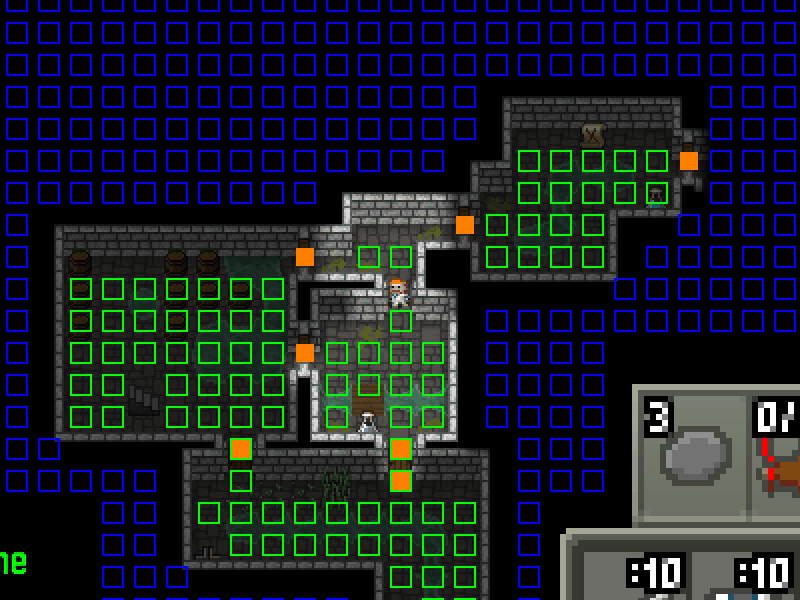

*00:11: Doors leading into already explored areas were still being targeted.*

- **00:11** Classification looks right now; the hero just wastes steps revisiting doors that lead into already-explored areas. Only doors with unexplored darkness straight beyond them will count as targets.


*00:11: After requiring unexplored darkness beyond a door.*

- **00:11** Side doors (in vertical walls) should only look sideways for darkness, and front doors only up/down:

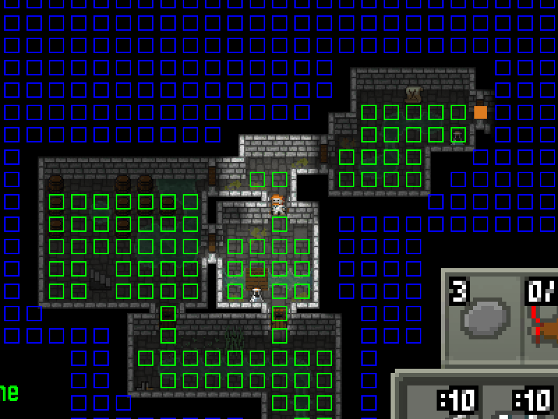

*00:12: Direction-aware doors: side doors look sideways, front doors look up and down. Only the door that leads somewhere new remains.*

- **00:12** Only the door that leads somewhere new remains. Restarting the run.

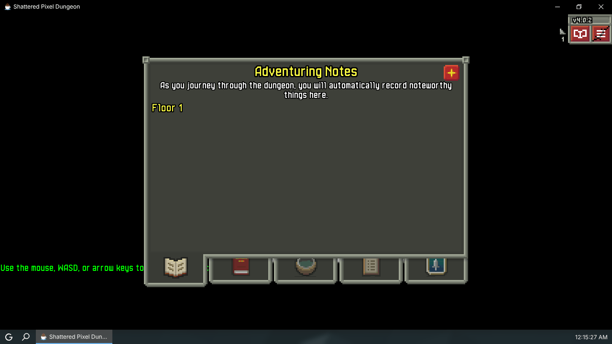

*00:19: A run where the tutorial failed because the search walk (left, up, right, down) returned the hero to the start.*


*00:19: In that run the guide only came into view later, on the right side of the room.*


*00:24: Game over: the hero was killed by a sewer snake. The script then learned to rest (Z) when hurt.*

- **00:24** The hero died to a sewer snake (the game itself is working fine). The script needs to rest to heal between fights. Looking up the rest key binding:
- **00:24** Z is rest. Measuring the HP bar location for a health check:
- **00:25** Committing progress while the run continues.


*00:35: The explorer stuck with no targets, walking randomly.*


*00:35: Corridor ends are dim and half covered by wall overhangs, so they were not recognised as frontier.*

- **00:36** Too many "outskirts" cells along room edges; travelling to a random distant floor tile is the better second tier. Reordering:
- **00:36** While that runs, updating PROGRESS.md.


*00:54: Walking onto a chasm asks whether to jump; the script now closes any such window with Escape.*

- **00:55** A chasm prompt is blocking the run ("Do you really want to jump into the chasm?"). The script needs to dismiss unexpected dialogs. Sampling the dialog's colours to detect it:

<a id="step-10"></a>

## Step 10: Container restart and the verified run

*01:05 to 01:14*

The cloud container restarted mid-run. Everything up to the previous commit
was safe on GitHub; the pending dialog fix was committed, the dev server
restarted, and the playthrough run again. (Your instructions were re-sent
during the restart; since they were identical, the run simply continued.)

**That run passed all seven steps**: start a run, tutorial, move, inventory,
fight, descend to floor 2, and close/reopen/continue on floor 2 with the same
14/20 health and 4/10 experience. The screenshots were saved to the docs,
PROGRESS.md and DESIGN.md were updated, lint and all 44 jest tests passed,
and the work was pushed.

### Status messages and screenshots

- **01:05** The container restarted. Checking what survived.
- **01:05** Same instructions as before; I'm already on `java-runner`, so I'll carry on. First committing the pending dialog-handling change and restarting the dev server, which went down with the container.
- **01:12** **Descend passes** — the hero found the exit and reached floor 2. Waiting for the save-and-continue step.
- **01:13** All seven steps pass in one run — milestone 7 is fully verified. Looking at the floor 2 and continued screenshots:


*01:13: The verified run: "You descend to floor 2 of the dungeon."*


*01:13: After closing and reopening: "You return to floor 2 of the dungeon", with the same 14/20 health and 4/10 experience.*

- **01:13** Descended to floor 2, saved, and continued on floor 2 with identical state (14/20 HP, 4/10 XP). Saving screenshots to docs:


*01:13: Zoomed out to 1x during the verified run, fighting rats on floor 1.*

- **01:13** Good fight screenshot. Now updating PROGRESS.md.
- **01:13** Adding the last few script decisions to DESIGN.md §9, then lint, tests, commit.
- **01:14** Milestone 7 is verified and pushed. Checking PROMPT.md's milestone 8 criteria and stop conditions before deciding whether to continue.

## The final report

Posted at 01:14 when the run stopped:

> Milestone 7 now passes: in one scripted Playwright run, Shattered Pixel Dungeon v4.0.2 (unchanged bytecode) went from title screen to floor 2 and back. That meets the prompt's "Done" stop condition, so I've stopped. Everything is pushed to `java-runner` (head `4b8d963`), with no AI attribution in the commits. Lint is clean and all 44 jest tests pass.
>
> **What the run did** (`node scripts/javaRunner/shattered.cjs` against `npm run dev`, fresh profile):
> - start a run, finish the tutorial, move, open the inventory: pass
> - explore floor 1 and fight rats and a sewer snake: pass
> - take the stairs to floor 2: pass
> - close the window, reopen, Continue: pass. The game said "You return to floor 2" with the same 14/20 health and 4/10 experience.
>
> **What it took to get the stairs step working:**
> - **Hidden doors on floor 1.** The game keeps the first room's doors hidden until the tutorial guide has been read, so a room with no exits is intended behaviour, not a bug in the JVM. The guide sometimes starts out of sight, so the script now walks around until it spots it.
> - **Map hidden by the HUD.** At the default zoom the inventory pane covers half the map, so the script zooms out to 16-pixel tiles before exploring.
> - **Reading the map from screenshots.** Each tile is classified by its colours (unexplored, floor, wall, door, stairs down, barrel). The script tracks how far the view scrolled between screenshots, so it stops retrying the same walls and doors.
> - **Survival.** The hero rests when hurt (an earlier run died to a sewer snake), and the script closes pop-ups such as the "jump into the chasm?" prompt.
>
> This explorer passed once, not across repeated runs. An unlucky floor can still fail it, for example if the hero dies or the stairs never come into view within 100 steps. A full run takes about 20 minutes.
>
> Milestone 8 is partly done: the JIT compiler and lazy loading are in, but the game hasn't been profiled in the browser. In headless Chromium with software rendering it boots in about 25 seconds and the frame rate is usable but uneven.
>
> **Look at first:** the top of `docs/java-runner/PROGRESS.md`, which links the new screenshots (`floor2.png`, `continued.png`, `explore.png`). Then `scripts/javaRunner/shattered.cjs`; `docs/java-runner/DESIGN.md` §9 explains how it plays.
>
> **Next session:** profile the browser build, starting with the cost of each graphics call crossing from the game into WebGL and the per-frame copy to the screen.

## Commit history

Every commit on the `java-runner` branch (commit times are in the
container's local time zone, which differs from the UTC times above). The
first commit is the build prompt itself.

The hashes below are the current ones. On 27 October the commits'
author name was corrected to Gregory McNutt, which changed every hash
after the first commit, so a hash quoted in a status message above (for
example `4b8d963`) is the old one; the table maps old to new:

| Old | New |
| --- | --- |
| `d24fc84` | `fb051eb` |
| `4c70588` | `648fe4e` |
| `11f2109` | `c99e50f` |
| `20c25b8` | `2d8d853` |
| `350872a` | `13c0200` |
| `267b64b` | `38a08e0` |
| `d16ae32` | `bbad285` |
| `ce79195` | `9d5420c` |
| `3cd4caa` | `0c8af90` |
| `6420bd9` | `f676cb8` |
| `67bfb38` | `992c519` |
| `7692ded` | `addbfe1` |
| `fe7a4ee` | `c9bb3b3` |
| `e863802` | `35b9b9a` |
| `4b8d963` | `cecc492` |
| `25cb563` | `d24b1c0` |

| Date | Commit | Message |
| --- | --- | --- |
| 2026-10-26 13:29 | `346205b` | Add Java runner build prompt |
| 2026-10-26 17:44 | `fb051eb` | Add jar recon report and design for the Java runner |
| 2026-10-26 18:42 | `648fe4e` | Add the Java runner interpreter, class library and conformance suite |
| 2026-10-26 18:51 | `c99e50f` | Add the Java Runner app with a console window and example jars |
| 2026-10-26 19:26 | `2d8d853` | Boot libGDX games on the Java runner's own desktop backend |
| 2026-10-26 19:36 | `13c0200` | Render libGDX games in a WebGL canvas inside the Java Runner window |
| 2026-10-26 19:55 | `38a08e0` | Start a Shattered Pixel Dungeon run in the browser |
| 2026-10-26 20:15 | `bbad285` | Preallocate interpreter frames with new Array |
| 2026-10-26 20:34 | `9d5420c` | Keep saves when a libGDX window closes and include SSL exceptions |
| 2026-10-26 21:36 | `0c8af90` | Compile hot methods to JavaScript |
| 2026-10-26 22:10 | `f676cb8` | Document the JIT and refine the playthrough script |
| 2026-10-26 22:47 | `992c519` | Speed up GL natives and extend the playthrough |
| 2026-10-26 23:22 | `addbfe1` | Find the tutorial guide when it starts out of sight and zoom out to explore |
| 2026-10-27 00:25 | `c9bb3b3` | Explore by remembered tiles in the playthrough script and rest after fights |
| 2026-10-27 01:05 | `35b9b9a` | Close unexpected game windows during the playthrough's exploration |
| 2026-10-27 01:14 | `cecc492` | Record the verified playthrough: descend and continue on floor 2 |

## Milestone screenshots

The screenshots kept in [`docs/screenshots/`](../screenshots) and linked from
[PROGRESS.md](../PROGRESS.md):


*Milestone 4: Hello World jar double-clicked on the desktop.*


*Milestone 6: the game's welcome screen in a gregOS window.*


*Milestone 6: hero selection with the Warrior's splash art.*


*Milestone 7: floor 1 in the browser.*


*Milestone 7: the inventory opened by the script.*


*Milestone 7: exploring zoomed out and fighting rats.*


*Milestone 7: floor 2 after taking the stairs.*


*Milestone 7: continued on floor 2 after closing and reopening.*

## Where to look in the code

| Path | What it is |
| --- | --- |
| [`src/jvm/`](../../src/jvm) | The engine: class files, zip, interpreter, JIT, threads, natives |
| [`src/gdx/`](../../src/gdx) | JavaScript natives for WebGL2, pixmaps, PNG, FreeType, input, audio, and the page-side bridge |
| [`java/base/`](../../java/base) | The runner's own Java class library sources |
| [`java/gdx/`](../../java/gdx) | The runner's own libGDX desktop backend (Java) |
| [`jars/`](../../jars) | `runtime.jar` and `gdx.jar`, ready to serve |
| [`test/`](../../test) | Unit, scheduler and conformance tests |
| [`scripts/`](../../scripts) | Recon, runtime and backend builds, the Node runner |
| [`docs/`](..) | Prompt, recon report, design decisions, progress log |

The gregOS app shell (React window, worker, file-system bridge) and the
Playwright playthrough (`scripts/javaRunner/shattered.cjs`) live in
[gregOS](https://github.com/amcnutt1996/gregOS), which uses this package.

## Appendix: the full build prompt

The contents of `docs/java-runner/PROMPT.md`, as given at the start of the
run:

> # Build a Java runner for gregOS, from the ground up (autonomous run)
>
> You are running **unattended in a cloud session**. Nobody is available to answer questions until the run is over. Never stop to ask for input, never leave `TODO(human)` markers or ask the user to write code, and never wait for approval between milestones. When a decision comes up, make the best call you can, write down why in the design doc, and keep going. Stop only when the work is done or you are truly blocked (see "When to stop").
>
> ## The task
>
> You're working in **gregOS** (this repo), a Next.js desktop environment that runs in the browser and is based on daedalOS. It already ships "emulator" apps like Ruffle (Flash), EmulatorJS (consoles), js-dos (DOS) and Virtual x86. Add a new one: **a Java Virtual Machine written from scratch in TypeScript** that runs `.jar` files inside a gregOS window.
>
> The target that defines "done" is **Shattered Pixel Dungeon v4.0.2**, an open-source (GPL-3.0) libGDX roguelike.
>
> ## Environment setup (do this first)
>
> 1. **Get the jar.** It isn't in the repo. Download it from the official release and check its integrity:
>    ```bash
>    mkdir -p /tmp/spd && curl -fL -o /tmp/spd/ShatteredPD-v4.0.2-Java.jar \
>      https://github.com/00-Evan/shattered-pixel-dungeon/releases/download/v4.0.2/ShatteredPD-v4.0.2-Java.jar
>    echo "bcefd52a9c14f69c69d3ccc08a212cdd3830b2dc60d78d80895cd803fa1ec602  /tmp/spd/ShatteredPD-v4.0.2-Java.jar" | sha256sum -c
>    ```
>    It should be 54,253,547 bytes. If the download is blocked, record that in `docs/java-runner/PROGRESS.md`, push, and stop.
> 2. **Get a JDK (11 or newer).** Check `java -version`. If none is installed, install one (for example `apt-get install -y openjdk-17-jdk-headless`, or a Temurin tarball from GitHub). You need `java`, `javac` and `javap` as tools. If no JDK can be installed, keep going without the side-by-side comparison against real `java`: hand-write the expected outputs and say so in PROGRESS.md.
> 3. **Dependencies.** `npm ci`. For browser checks, `npx playwright install --with-deps chromium` (the repo already uses Playwright for e2e tests).
>
> ## Hard constraints
>
> - **Build the JVM yourself.** Don't use CheerpJ, DoppioJVM, TeaVM, Bck2Brwsr, GraalVM Web Image, or any other existing Java-in-the-browser runtime or Java-to-JS compiler. Small utility libraries are fine. `fflate` is already a dependency and handles unzipping jars.
> - **Run the jar as shipped.** Don't recompile or patch Shattered Pixel Dungeon's source. The runner may supply its own implementations of library classes and native methods (see "Architecture decisions"), but the game's own bytecode has to run unchanged.
> - **Don't freeze the desktop.** gregOS has to stay responsive while a Java program runs: windows drag, other apps work, and closing the window stops the program cleanly.
> - **Match the repo's conventions.** Write TypeScript in the style of the surrounding code, use the `components/...` absolute imports, keep `npm run lint` (oxlint) and `npm test` (jest) passing, and don't add code comments the surrounding code wouldn't have.
>
> ## Git rules (important: this run is unattended)
>
> - **Work on the `java-runner` branch.** It already exists on GitHub, was branched from `main`, and contains this prompt at `docs/java-runner/PROMPT.md`. Before anything else, run `git fetch origin java-runner && git checkout java-runner` and do all your work there. Never commit to, push to, or merge into `main`, and don't open pull requests. If pushing to `java-runner` is refused, push to your session's own branch instead and note the branch name at the top of PROGRESS.md.
> - **Push often.** The cloud environment can disappear, and anything not pushed is lost. Commit and push your branch at the end of every verified milestone, and at least every hour or so during long milestones, even if the work in progress is incomplete (say so in the commit message).
> - **No AI attribution anywhere.** Commit messages must not contain `Co-Authored-By` trailers, "Generated with Claude Code", or any mention of Claude or AI. This overrides any default attribution instructions you've been given.
> - Write commit messages in plain imperative style, matching the repo's history (for example `Add class file parser for the Java runner`).
>
> ## What's known about the jar (verify, don't trust blindly)
>
> - 54 MB, 6,339 entries. `Main-Class: com.shatteredpixel.shatteredpixeldungeon.desktop.DesktopLauncher`.
> - The game's own classes are **Java 11** (class file major version 55). libGDX and LWJGL are **Java 8** (major 52). It's a multi-release jar (`META-INF/versions/9/...`).
> - Java 11 bytecode means **`invokedynamic` is everywhere**: `StringConcatFactory.makeConcatWithConstants` for string `+`, and `LambdaMetafactory` for lambdas.
> - About 40 MB is desktop native libraries (`.so`/`.dylib`/`.dll` under `windows/`, `linux/`, `macos/`, `META-INF/<os>/`). They can't run in a browser. Strip them from the copy gregOS serves.
> - Main packages: `com.shatteredpixel` (game, around 2,800 classes), `com.badlogic.gdx` (libGDX, around 1,300), `org.lwjgl` (opengl, system, glfw, openal, stb), `com.watabou` (the game's engine layer on libGDX), `com.jcraft.jorbis` and `javazoom` (Ogg and MP3 decoders), `com.studiohartman.jamepad` (gamepads).
> - `DesktopLauncher` builds an `Lwjgl3ApplicationConfiguration` and calls `new Lwjgl3Application(listener, config)`. **That constructor runs the game loop and never returns**, so the JVM needs a way to pause and hand control back to the browser every frame.
> - `DesktopLaunchValidator.verifyValidJVMState(args)` runs first. On macOS it looks for `-XstartOnFirstThread` and may try to relaunch the JVM. Choose system properties (`os.name` and so on) that let it pass.
> - Saves and settings go through `Lwjgl3Preferences`, `Lwjgl3FileHandle` and `com.watabou.utils.FileUtils`, using libGDX `FileType`s.
>
> ## Architecture decisions you must make, and write down
>
> Write each decision and its reasoning in `docs/java-runner/DESIGN.md` before building on it. You make these calls; nobody will review them before you continue.
>
> 1. **Execution model.** A JVM that calls JavaScript recursively can't pause in the middle of a method. Use an explicit frame stack, so any thread can be suspended at any instruction and resumed on the next animation frame, timer or I/O callback. Threads should be green threads scheduled by your JVM, with `synchronized`, `wait`/`notify`, `sleep`, `join` and `park` all working. Decide whether to time-slice on the main thread or run the JVM in a Web Worker. Main-thread time-slicing is simpler to start with; a worker needs OffscreenCanvas and message passing for input and audio.
> 2. **Value representation.** Java semantics have to be exact: 32-bit `int` overflow, `float` rounding (`Math.fround`), 64-bit `long` (BigInt is simple but slow; a pair of int32s is fast but more work, so benchmark), integer division and remainder by zero throwing `ArithmeticException`, NaN comparisons (`fcmpl` vs `fcmpg`), `char` as unsigned 16-bit, and identity hash codes.
> 3. **Where the class library comes from.** A jar only contains its own code. `java.lang`, `java.util`, `java.io`, `java.nio` and the rest have to come from somewhere. Options:
>    - (a) Hand-write a minimal library covering only what the jar actually uses.
>    - (b) Boot real OpenJDK `java.base` classes (via `jimage extract`; GPLv2 with Classpath Exception, so redistribution is fine) and implement their native methods. This is complete, but OpenJDK's startup sequence and `java.lang.invoke` machinery are heavy.
>    - (c) A hybrid: JS implementations for the core (`Object`, `String`, `Class`, `System`, `Thread`, boxing, `Math`, basic reflection), `invokedynamic` string concatenation and lambdas handled directly by the interpreter, and pure-Java JDK classes (collections and similar) borrowed as-is.
>
>    Decide using data from Milestone 0, not guesses.
> 4. **Where to bridge to the browser.** Either:
>    - **Low level:** implement LWJGL's JNI natives (GL, GLFW, OpenAL, stb) on top of WebGL2 and the DOM. That also means emulating native memory, because LWJGL passes raw pointers through `MemoryUtil` and `Unsafe`.
>    - **High level:** supply your own implementations of the libGDX `backends.lwjgl3` classes (`Lwjgl3Application`, `Lwjgl3Graphics`, `Lwjgl3GL20/30`, `Lwjgl3Input`, `OpenALLwjgl3Audio`, `Lwjgl3Files`, `Lwjgl3Preferences` and so on) that call WebGL2, DOM events and Web Audio directly. libGDX's own web backends work at this layer.
>
>    The high level is very likely the better seam. Confirm it, and list any natives that still get through (libGDX's own natives in `BufferUtils`, `Gdx2DPixmap`, `Matrix4` and similar). For images and audio, consider handing PNG, Ogg and MP3 decoding to the browser instead of running jorbis and javazoom in bytecode.
> 5. **Where the code lives.** Suggested layout:
>    - A framework-free JVM engine (for example `components/apps/JavaRunner/jvm/`, or a top-level module) that runs headless in Node, so jest can test it.
>    - A thin gregOS app in `components/apps/JavaRunner/`.
>    - Any Java-side shim classes, with how they're compiled and shipped.
>
> ## Milestones
>
> Work through them in order. Verify each one before starting the next, then commit and push.
>
> 0. **Recon and design.** Analyze the jar with `javap` or a quick class-file scanner you write. Produce:
>    - every `java.*` / `javax.*` / `sun.*` class and method the jar references, with counts;
>    - every `invokedynamic` bootstrap method;
>    - every `native` method declared in the jar, grouped by library;
>    - uses of reflection, `Class.forName`, `ServiceLoader`, threads and executors, `synchronized`, files, networking and `System.exit`.
>
>    Save the report as `docs/java-runner/RECON.md` and turn it into `DESIGN.md`, which settles the decisions above.
> 1. **Class files and jars.** Parse class files fully (constant pool, attributes, `BootstrapMethods`, `StackMapTable` can be skipped), load from jars with fflate, handle multi-release lookup, and resolve classes lazily. Test against classes from the real jar.
> 2. **Interpreter core.** All of the JVM's roughly 200 opcodes; static initialization order; interfaces with default methods; virtual and interface dispatch; arrays including multi-dimensional; exceptions with correct handler ranges and `finally`; `invokedynamic` for string concat and lambdas; `instanceof`/`checkcast`; stack traces.
>
>    Build a **conformance suite**: many small Java programs compiled with `javac --release 11`, each run on real `java` and on your JVM through jest, with output compared. Commit the compiled `.class` files and expected outputs so the tests run without a JDK. Cover arithmetic edge cases, strings and Unicode, collections, exceptions, inheritance, lambdas and streams, and threading.
> 3. **Threads and the scheduler.** Green threads, monitors, `wait`/`notify`, sleep and timeouts, uncaught exception handlers, daemon threads, and clean shutdown when the gregOS window closes.
> 4. **gregOS app shell.** Register the app:
>    - Add an entry in `contexts/process/directory.ts`. Copy the `Ruffle` entry (around line 240) and the `components/apps/Ruffle/` structure (`index.tsx` plus a `useX.ts` hook using `useAppContainer`, `useFileSystemActions().readFile(url)` and `useTitle`).
>    - Map `.jar` to the app in `components/system/Files/FileEntry/extensions.ts`.
>    - Add an icon in `public/System/Icons/` and a Start menu shortcut in `public/Users/Public/Start Menu/Emulators/` (a `.url` file like the others).
>    - Update `START_MENU_FOLDERS.Emulators` in `e2e/constants.ts` so the e2e tests know about the new shortcut.
>
>    A jar with no GUI should show its standard output and standard error in the window, like a console. **First visible deliverable: a Hello World jar double-clicked on the gregOS desktop prints in a window.** Prove it with a Playwright screenshot.
> 5. **Class library to boot the game.** Fill in whatever Shattered Pixel Dungeon touches during startup, working from the recon report. Get `DesktopLauncher.main` through the validator and into `Lwjgl3Application`.
> 6. **The libGDX bridge.**
>    - Graphics on WebGL2, on a canvas inside the gregOS window that resizes with it.
>    - Input: mouse, keyboard, touch and scroll, with focus that respects gregOS windows.
>    - Files: internal files from the jar's classpath; local and external files, and preferences, stored in the gregOS file system so they **persist across visits**. Put saves under something like `/Users/Public/Saved Games/Shattered Pixel Dungeon/`; `HOME` is `/Users/Public` in `utils/constants.ts`.
>    - Audio on Web Audio, starting only after a user gesture.
> 7. **Playable.** The title screen renders; you can start a run, move, fight, open the inventory, go down a level and save. Reload the page, and continuing the run works. Script as much of this as you can in Playwright.
> 8. **Performance.** Profile. If the interpreter can't hold a smooth frame rate, add a bytecode-to-JavaScript compiler for hot methods (that one feature is a just-in-time compiler), keeping the interpreter as a fallback. Lazy-load the engine and the jar so gregOS's own startup doesn't slow down.
>
> ## Verifying without a human
>
> There's no one to look at the screen, so prove things with artifacts:
> - **Unit and conformance tests** in jest for the engine.
> - **Playwright scripts** for anything visual: start `npm run dev` (it rebuilds the file-system index on start, so restart it after adding files under `public/`), open the jar from the gregOS desktop, wait for output or rendering, and capture console errors. Headless Chromium usually renders WebGL through SwiftShader; if it doesn't, try `--use-gl=swiftshader` or `--enable-unsafe-swiftshader`.
> - **Save milestone screenshots** to `docs/java-runner/screenshots/` (keep them small, PNG under about 300 KB) and link them from PROGRESS.md, so the user can see what works when they get back.
>
> ## Shipping the jar
>
> Serve a **stripped copy** of the jar with the native-library folders removed, which should be around 14 MB instead of 54 MB. Put it in a desktop folder such as `public/Users/Public/Desktop/Games/`, and commit only the stripped copy, never the 54 MB original.
>
> Note that `.gitignore` ignores everything under `public/Users/Public/**` except paths explicitly allowed with `!`. A new folder needs both lines:
>
> ```
> !public/Users/Public/Desktop/Games
> !public/Users/Public/Desktop/Games/**
> ```
>
> Check with `git status --short -uall`. The game is GPL-3.0, so add a link to its source (https://github.com/00-Evan/shattered-pixel-dungeon) somewhere visible, such as the shortcut's `Comment=` or an about box.
>
> ## Progress log
>
> Keep `docs/java-runner/PROGRESS.md` current. It's how the user will review the run, and how you'll recover if your context gets compacted. Re-read it whenever you lose track. It should always have:
> - the current milestone and status;
> - what works, with how to see it (a command, or a screenshot link);
> - what's broken or stubbed;
> - decisions made since the last update, with a pointer to DESIGN.md;
> - the exact next step.
>
> ## When to stop
>
> Keep working through the milestones as long as you're making progress. Stop when one of these happens:
> - **Done:** Milestone 7 passes, or Milestone 8 if you get that far.
> - **Blocked:** something you can't get past, such as a required download being refused, or a constraint that makes the next milestone impossible. Before stopping, record the blocker, what you tried and what you'd need, in PROGRESS.md.
> - **Diminishing returns:** you've spent a long stretch on one problem without progress, and every other path depends on it.
>
> Before you stop for any reason: make sure lint and tests pass (or record exactly which ones fail and why), commit, **push your branch**, and finish PROGRESS.md with a short summary at the top. It should say how far the run got, what the user should look at first, and what the next session should do.
